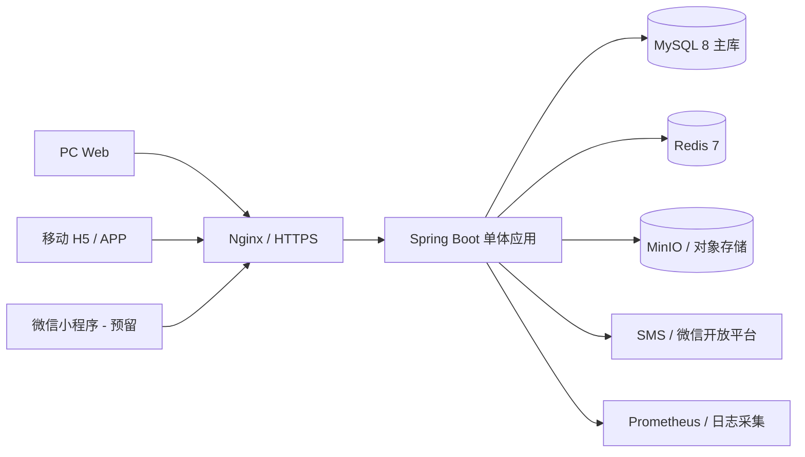
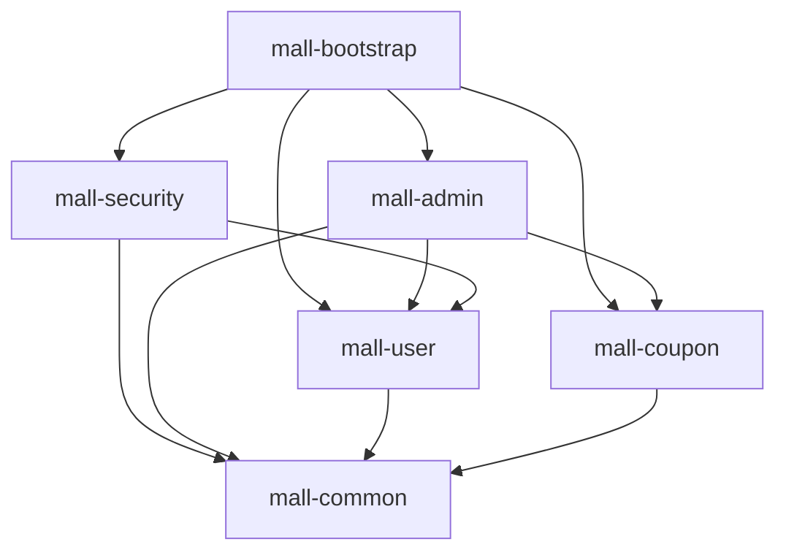
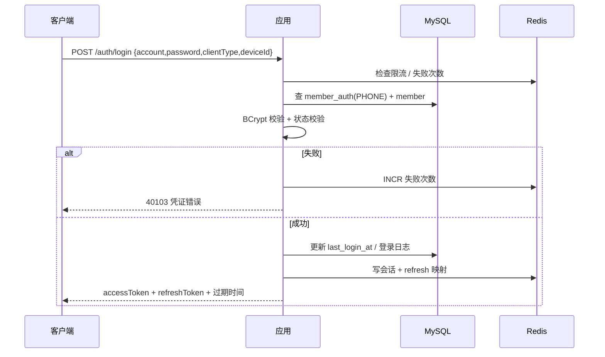
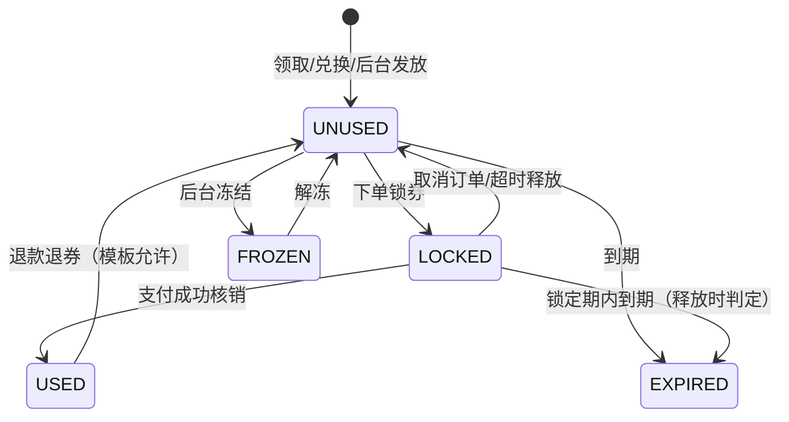

≠# 01 总体架构设计

> 项目：电商系统后端（server）
> 版本：v1.0（方案阶段）
> 技术基线：JDK 21 / Spring Boot 3.5.x / MySQL 8 / Redis 7
> 一期范围：会员、认证授权、优惠券

---

## 1. 目标与范围

### 1.1 建设目标

做一个**可直接上生产的模块化单体**后端：

- 单仓库、单进程、单数据库，部署与运维成本低；
- 领域边界清晰，后续订单、商品、支付、营销可按模块拆分，不推翻现有代码；
- 认证与权限从第一天就按多端、多身份设计，小程序后续接入只增加适配层；
- 优惠券按真实交易链路设计（试算 → 锁券 → 核销 → 释放/退券），避免"只能领不能用"的演示型实现；
- 关键路径具备限流、幂等、防超发、防越权、可观测能力。

### 1.2 一期范围

| 领域 | 能力 |
| --- | --- |
| 会员 | 注册、密码登录、短信验证码登录、刷新令牌、退出登录、多端会话管理、个人资料、收货地址 |
| 认证 | 会员端 / 管理端双身份体系；JWT + Redis 会话；强制下线；密码与凭证安全 |
| 权限 | 管理端 RBAC：管理员、角色、权限（目录/菜单/按钮/API）、角色授权、权限缓存、操作审计 |
| 优惠券 | 券模板管理、发券（领取/券码/后台发放）、我的券、券码兑换、可用券试算、智能选券、锁券/核销/释放、过期处理、退券、叠加互斥规则 |
| 多端 | PC Web、移动 H5、APP 共用会员接口；小程序登录与手机号绑定预留 |
| 基础设施 | 统一响应/异常、参数校验、限流、幂等、缓存、定时任务、日志与指标、Flyway、Docker 部署 |

### 1.3 一期不做（但预留边界）

商品、SKU、库存、购物车、订单、支付、退款、物流、积分、会员等级权益、营销活动、消息推送、分布式事务、微服务拆分、多租户。

订单域接入时，通过优惠券模块暴露的 `CouponFacade` 调用，不直接访问优惠券表。

### 1.4 非功能目标

| 指标 | 目标 |
| --- | --- |
| 可用性 | 99.9%（单实例 + 快速重启，后续可水平扩容） |
| 登录接口 | P99 ≤ 200ms，500 TPS |
| 领券接口 | P99 ≤ 150ms，1000 TPS（热点券） |
| 我的券 / 券中心 | P99 ≤ 120ms |
| 错误率 | 5xx < 0.1% |
| 数据一致性 | 券不超发、不重复核销；写操作幂等 |
| 恢复目标 | RPO ≤ 5 分钟（binlog），RTO ≤ 30 分钟 |

---

## 2. 架构原则

1. **模块化单体**：一个 Spring Boot 应用，按领域拆 Maven 模块；模块间只能通过 `api/facade` 接口或领域事件通信，禁止跨模块访问 Mapper / PO。
2. **先边界、后拆分**：现在不引入注册中心、网关、MQ；等订单域落地后再评估。所有跨域调用都走进程内接口，未来替换为 RPC 时调用方无感。
3. **数据库是事实来源**：缓存只做加速，Redis 不承担最终一致性的唯一职责；库存类扣减最终以数据库条件更新为准。
4. **认证与业务分离**：Token 只承载身份与版本号，不承载权限列表；权限与用户状态变化可通过 Redis 即时生效。
5. **接口按端分组、能力共用**：PC / H5 / APP 不做三套业务代码，通过 `X-Client-Type` 做少量差异化（登录方式、返回字段、跳转配置）。
6. **金额只用整数分**，时间统一 `Asia/Shanghai`，ID 使用雪花算法。
7. **默认可观测**：每个请求有 `traceId`，关键业务有指标，写操作有审计。
8. **失败安全**：优惠券宁可少发不可超发；敏感接口默认限流；异常不泄露堆栈与敏感字段。

---

## 3. 总体架构



- Nginx：TLS 终止、静态资源、限流兜底、安全响应头、真实 IP 透传。
- 应用：单 JAR，内嵌 Tomcat；按模块组织，单库多表。
- MySQL：业务数据与审计数据；Flyway 管理版本。
- Redis：会话、权限缓存、券库存预扣、验证码、限流、分布式锁。
- 对象存储：头像等用户上传文件，应用只存 URL。
- 外部服务：短信、微信登录，均通过适配器接口隔离，开发环境提供 Mock。

### 3.1 部署形态

| 环境 | 形态 |
| --- | --- |
| dev | 本地 Docker Compose（MySQL + Redis + 应用） |
| test | 单实例 + 独立 MySQL/Redis，Flyway 自动迁移 |
| prod | Nginx + 2 个应用实例（无状态）+ MySQL 主从（一期可单主）+ Redis 主从/哨兵 |

应用保持无状态：会话在 Redis、文件在对象存储，可直接水平扩容。定时任务用 ShedLock 保证多实例只执行一次。

---

## 4. 技术选型

| 分类 | 选型 | 说明 |
| --- | --- | --- |
| JDK | 21 (LTS) | 虚拟线程可用；长期支持 |
| 框架 | Spring Boot 3.5.x | Web、Validation、AOP、Actuator |
| 安全 | Spring Security 6.x | 过滤器链、方法级鉴权、密码编码 |
| 持久层 | MyBatis-Plus 3.5.x（boot3 starter） | CRUD 高效，复杂 SQL 可手写 XML |
| 数据库 | MySQL 8.0 | InnoDB、utf8mb4、JSON 字段 |
| 迁移 | Flyway 11.x + `flyway-mysql` | 版本化 DDL，禁止 `ddl-auto` |
| 缓存/会话 | Redis 7 + Lettuce | 会话、缓存、Lua 原子操作 |
| 分布式锁 | Redisson 3.x | 仅用于定时任务、批量操作；领券主链路用 Lua + DB CAS |
| JWT | jjwt 0.12.x | HS256 + `kid` 预留轮换 |
| 对象映射 | MapStruct 1.6.x | DTO / PO / Domain 转换 |
| 参数校验 | Jakarta Validation | 分组校验（Create/Update） |
| API 文档 | springdoc-openapi 2.8.x | 按 member / admin 分组，生产关闭 |
| 日志 | SLF4J + Logback + logstash-encoder | JSON 输出、MDC traceId、脱敏 |
| 指标 | Micrometer + Prometheus | HTTP、连接池、Redis、业务指标 |
| 定时任务 | Spring Scheduling + ShedLock | 过期券、库存对账 |
| 测试 | JUnit 5 + Testcontainers + ArchUnit | 集成测试用真实 MySQL/Redis，架构边界测试 |
| 构建 | Maven 3.9 + Maven Wrapper | 多模块 |
| 部署 | Docker 多阶段构建 + Docker Compose | 后续可上 K8s |

**不引入**：Spring Cloud、Nacos、Kafka/RocketMQ、ShardingSphere、XXL-Job、Elasticsearch。理由：当前数据量与团队规模不需要，先降低复杂度；优惠券的异步解耦用 Spring 事务事件 + 预留 Outbox 表。

---

## 5. 工程结构

### 5.1 目录结构

```text
server/
├── pom.xml                     # 父 POM：版本管理、插件、模块聚合
├── mvnw / mvnw.cmd
├── mall-common/                # 通用能力（无业务依赖）
├── mall-security/              # 认证、会话、RBAC、过滤器、权限注解
├── mall-user/                  # 会员域
├── mall-coupon/                # 优惠券域
├── mall-admin/                 # 管理端聚合接口（会员管理等）
├── mall-bootstrap/             # 启动模块、配置、Flyway、集成测试
├── docs/                       # 本方案文档
└── deploy/
    ├── docker-compose.yml
    ├── nginx/
    └── sql/                    # 仅初始化账号等运维脚本（业务 DDL 在 Flyway）
```

### 5.2 模块依赖



规则：

- `mall-common` 不依赖任何业务模块。
- `mall-user`、`mall-coupon` 互不依赖，跨域通过 facade。
- `mall-security` 依赖 `mall-user` 以完成会员凭证校验；管理端账号与 RBAC 在 security 内部。
- `mall-admin` 只做管理端聚合编排，不直接写其他模块的 Mapper。
- `mall-bootstrap` 只负责启动、配置与 Flyway，不写业务代码。

### 5.3 模块内分层

```text
com.shopmall.coupon
├── api
│   ├── controller        # HTTP 入口，只做参数校验与编排调用
│   ├── dto               # Request / Response / VO
│   └── facade            # 暴露给其他模块的接口与 DTO
├── application
│   └── service           # 用例编排、事务边界、幂等控制
├── domain
│   ├── model             # 实体、值对象、枚举、状态机
│   ├── service           # 纯领域计算：匹配、折扣、叠加
│   └── repository        # 仓储接口
├── infrastructure
│   ├── persistence       # PO、Mapper、Repository 实现
│   ├── cache             # Redis 缓存与 Lua 脚本
│   ├── job               # 定时任务
│   └── client            # 外部服务适配器
└── support               # 转换器、局部配置
```

调用方向：`api → application → domain ← infrastructure`。禁止 Controller 直接调 Mapper，禁止 Domain 依赖 Spring Web。

### 5.4 边界约束（ArchUnit）

在 `mall-bootstrap` 的测试中强制：

- `..api..` 不得依赖 `..infrastructure..`；
- `..domain..` 不得依赖 `..springframework.web..`、`..mybatis..`；
- `mall-coupon` 不得依赖 `mall-user` 的 `infrastructure` / `api.controller`；
- 跨模块只允许依赖对方的 `..api.facade..`；
- Controller 不得直接使用 PO。

### 5.5 包命名

基础包 `com.shopmall`，模块包名与 artifact 一致：`common`、`security`、`user`、`coupon`、`admin`、`bootstrap`。

---

## 6. 多端接入方案

### 6.1 端识别

所有会员端请求可带：

| Header | 必填 | 说明 |
| --- | --- | --- |
| `X-Client-Type` | 登录/关键接口必填 | `PC` / `H5` / `APP` / `MINI` |
| `X-Device-Id` | 登录必填 | 客户端生成的稳定设备标识（UUID） |
| `X-App-Version` | 否 | 客户端版本，用于兼容与灰度 |
| `Authorization` | 否 | `Bearer <accessToken>` |
| `X-Request-Id` | 否 | 客户端请求 ID，用于排查 |
| `Idempotency-Key` | 写操作建议 | 幂等键，8–64 位 |

服务端将端类型写入会话，后续用于：多端会话列表、风控、差异化配置；**不用于复制业务代码**。

### 6.2 接口分组

```text
/api/v1/member/**    会员端（PC / H5 / APP / 小程序共用）
/api/v1/admin/**     管理端
/actuator/**         仅内网
```

- 绝大多数能力（登录、资料、地址、优惠券）共用同一套接口。
- 差异通过以下方式处理：
  - 登录方式：密码 / 短信（全端）；微信小程序（`MINI` 专属接口）。
  - 返回字段：按端裁剪用 `@JsonView` 或独立 VO，仅在必要时使用。
  - 跳转/配置：由前端处理，服务端只返回业务数据。
- 小程序接入时新增：
  - `POST /api/v1/member/auth/wechat/mini/login`（code 换 openid/unionid）
  - 手机号绑定/解密接口
  - 现有 JWT / 会话体系完全复用。

### 6.3 版本策略

- URL 带主版本 `v1`；破坏性变更升 `v2`，旧版本保留至少一个迭代周期。
- 非破坏性字段新增直接兼容；字段删除先标记 `@Deprecated` 并观察调用量。
- 数据库变更只新增、不直接删列；废弃列先停止写入，后续版本清理。

---

## 7. 认证与会话设计

### 7.1 双 Realm

| Realm | 身份表 | 接口前缀 | 说明 |
| --- | --- | --- | --- |
| `member` | `member` / `member_auth` | `/api/v1/member` | C 端消费者 |
| `admin` | `sys_admin` | `/api/v1/admin` | 后台运营/管理员 |

JWT `aud` 声明区分 Realm；会员 Token 无法访问管理端接口，反之亦然。两套过滤器链互不复用。

### 7.2 Token 设计

- **Access Token**：JWT，默认 30 分钟；`HS256`，密钥来自环境变量，支持 `kid` 轮换。
- **Refresh Token**：不透明随机串（32 字节），默认 14 天（APP/MINI 可配置 30 天）；只存哈希。
- Claims：

```json
{
  "iss": "shop-mall",
  "sub": "100000000000000001",
  "aud": "member",
  "jti": "3f2c...",
  "did": "device-uuid",
  "ct": "APP",
  "tv": 3,
  "iat": 1763700000,
  "exp": 1763701800
}
```

`tv` 为用户 token 版本号，改密码 / 强制全端下线时递增。

### 7.3 Redis Key 设计

| Key | 类型 | TTL | 用途 |
| --- | --- | --- | --- |
| `auth:sess:member:{memberId}:{deviceId}` | Hash | = refresh TTL | 会话：jti、refreshHash、端类型、登录时间、IP |
| `auth:refresh:{sha256(refreshToken)}` | String | = refresh TTL | refresh → memberId/deviceId |
| `auth:tokenver:member:{memberId}` | String | 30m | token 版本缓存（DB 回源） |
| `auth:permver:admin:{adminId}` | String | 30m | 权限版本 |
| `auth:perm:admin:{adminId}` | Set | 30m | 权限码集合 |
| `auth:fail:login:{realm}:{account}` | String | 15m | 登录失败计数 |
| `sms:code:{scene}:{phoneHash}` | String | 5m | 短信验证码 |
| `rate:{action}:{dimension}` | String | 窗口 | 限流计数 |
| `coupon:stock:{templateId}` | String | 活动结束后 1d | 领券库存预扣 |
| `coupon:user:{templateId}:{memberId}` | String | 活动结束后 1d | 用户已领数量 |

### 7.4 登录流程（密码）



### 7.5 请求鉴权

过滤器链顺序：

```text
TraceIdFilter → RateLimitFilter（仅敏感路径）→ JwtAuthFilter → Spring Security 授权 → 业务
```

`JwtAuthFilter` 做：

1. 解析并校验 JWT（签名、`exp`、`aud`、`iss`）；
2. 从 Redis 读取会话，校验 `jti` 与会话一致（支持即时踢下线）；
3. 校验 `tv` 与当前用户 token 版本；
4. 构建 `LoginUser` 放入 `SecurityContext` 与线程上下文。

Redis 校验为一次 `HMGET`，失败回源数据库后重建；Redis 不可用时**会员只读接口降级为仅验签**（可配置），管理端接口直接拒绝。

### 7.6 刷新、退出与强制下线

- **刷新**：Refresh Token 轮换。旧 refresh 使用即失效；检测到旧 token 重放时，撤销该设备会话并记安全日志。
- **退出当前设备**：删除 `auth:sess:*:{deviceId}` 与 refresh 映射。
- **退出全部设备**：删除该用户所有会话 + `token_version + 1`。
- **改密码**：`token_version + 1`，清空所有会话，重新登录。
- **限制**：单会员最多 5 个活跃设备，超出按最久未活跃淘汰。
- **Access Token 黑名单**：本项目不单独维护 jti 黑名单，依赖会话存在性即可即时失效，减少一次 Redis 写入。

### 7.7 凭证安全

- 密码：`DelegatingPasswordEncoder` + BCrypt（cost 12），存储格式 `{bcrypt}$2a$...`；未来可平滑升级 Argon2。
- 密码策略：8–64 位，至少包含字母与数字；禁止与用户名/手机号相同；注册与改密校验。
- 短信验证码：6 位数字，5 分钟有效；60 秒重发间隔；单手机号 10 条/天；单 IP 20 条/天；验证成功即删除（一次性）。
- 登录风控：同账号 5 次失败锁定 15 分钟；同 IP 10 次/分钟；连续失败 3 次后要求图形验证码（预留 `CaptchaVerifier` 接口）。
- 手机号：AES-256-GCM 加密存储 + HMAC-SHA256（带 pepper）哈希用于唯一索引与精确检索；展示用脱敏字段。
- 日志脱敏：手机号、密码、验证码、Token 一律不落日志；请求体日志对敏感字段打码。

---

## 8. 权限模型（管理端 RBAC）

### 8.1 模型

```text
sys_admin ──< sys_admin_role >── sys_role ──< sys_role_permission >── sys_permission
```

- `sys_permission` 同时表达目录、菜单、按钮、API 四类权限，用树形结构组织。
- 权限码规范：`<domain>:<resource>:<action>`，例如：
  - `coupon:template:create`
  - `coupon:template:publish`
  - `member:member:view`
  - `system:admin:assign-role`
- 超级管理员角色 `SUPER_ADMIN` 拥有全部权限（代码内短路）。
- `sys_role.data_scope` 预留数据范围（1 全部 / 2 仅本人），一期管理端仅实现"全部"和"本人"两种；组织架构后续扩展。

### 8.2 鉴权方式

- URL 级：`/api/v1/admin/**` 要求 `aud=admin` 且已认证；登录、刷新接口放行。
- 方法级：`@PreAuthorize("@perm.has('coupon:template:create')")`。
- 权限加载：登录时按角色聚合权限码；`PermissionService` 缓存到 Redis；角色/权限变更时 `auth:permver` 递增，下一次请求自动刷新。
- 菜单：`GET /api/v1/admin/auth/me` 返回权限码集合与菜单树，前端据此渲染路由与按钮。

### 8.3 越权防护

- 管理端所有写操作记录操作日志（操作人、路径、参数摘要、结果、traceId）。
- 会员端一律从 Token 取 `memberId`，**禁止**信任请求体/URL 中的 `memberId`；地址、券等资源必须校验归属。
- 对象级校验统一放在 application 层：`loadOwnedCoupon(memberId, couponId)`，不存在或不属于本人统一返回"资源不存在"，避免枚举。
- 管理端敏感操作（授权、发券、冻结）要求二次确认参数与操作原因，并写审计。

### 8.4 初始化

Flyway 初始化：

- 角色：`SUPER_ADMIN`；
- 权限树：系统管理（管理员、角色、权限、操作日志）、会员管理、优惠券管理（模板、券码、实例、叠加规则）；
- 初始管理员：用户名 `admin`，密码通过环境变量注入的 BCrypt 哈希，首次登录强制改密（字段 `pwd_reset_required`）。

---

## 9. 优惠券域设计

### 9.1 领域模型

| 对象 | 说明 |
| --- | --- |
| 券模板 `CouponTemplate` | 定义券的类型、面额/折扣、门槛、适用范围、发放总量、限领、有效期、叠加组、退款策略 |
| 用户券 `CouponInstance` | 用户领取后的券实例，独立有效期与状态 |
| 券码 `CouponCode` | 预生成的兑换码，可批量生成、作废、兑换 |
| 领取记录 `CouponReceiveRecord` | 领券审计与幂等依据 |
| 使用记录 `CouponUseRecord` | 锁券/核销/释放/过期/退券的状态流水 |
| 叠加规则 `CouponStackRule` | 不同叠加组之间是否可叠加、最大叠加张数 |

### 9.2 券类型与计算

| 类型 | 字段 | 计算 |
| --- | --- | --- |
| 满减券 | `threshold_amount`、`discount_amount` | 适用金额 ≥ 门槛时减固定金额 |
| 折扣券 | `threshold_amount`、`discount_rate`、`max_discount_amount` | 优惠 = 适用金额 × (1 − 折扣率)，封顶 |
| 无门槛券 | `threshold_amount = 0`、`discount_amount` | 直接减固定金额 |

规则：

- 金额单位为分，`BIGINT`；折扣率 `DECIMAL(4,2)`，如 `8.50` 表示 8.5 折。
- 优惠金额按 `HALF_UP` 保留到分，最小 1 分；实付不低于 0。
- 门槛按**适用商品金额**计算，不是购物车总额；适用范围支持全场 / 类目 / SPU / SKU，含包含与排除。
- 同一订单多张券时，优惠按商品金额比例分摊到行（订单域落地时实现），用于退款计算。

### 9.3 适用范围

`scope_type`：`ALL` / `CATEGORY` / `SPU` / `SKU`。

`scope_values` 使用 JSON：

```json
{ "include": [101, 102], "exclude": [103] }
```

- `ALL` 时为空；
- 匹配优先级：SKU > SPU > CATEGORY > ALL；
- 一期使用 JSON 存储，查询在应用层完成（用户券数量有限）；后续如需按类目检索，再拆 `coupon_template_scope` 表。

### 9.4 有效期

两种模式：

1. **固定区间**：`valid_start` ~ `valid_end`，所有领取的券相同。
2. **领取后 N 天**：`valid_start = receive_time`，`valid_end = receive_time + N 天 − 1 毫秒`。

过期处理：

- 读路径惰性判断（查询时过滤 `valid_end > NOW()`）；
- 定时任务批量把 `UNUSED` 且已过期的券置为 `EXPIRED`（每 10 分钟，分批 500 条，ShedLock 防并发）。

### 9.5 状态机



所有状态变更使用 `UPDATE ... WHERE id=? AND status=? AND version=?` 条件更新，失败即冲突，不做"先查后改"。

### 9.6 叠加与互斥

- 每个模板属于一个叠加组 `stack_group`（如 `PLATFORM`、`CATEGORY`、`BRAND`）。
- **同组默认互斥**：同一订单同一组最多用 1 张。
- 不同组之间由 `coupon_stack_rule` 决定是否可叠加，以及最大叠加张数（默认 3）。
- 模板 `stackable = 0` 表示该券不可与任何其他券叠加。
- 试算时最多考虑 10 张候选券，避免组合爆炸。

### 9.7 试算与智能选券

输入：商品行（SKU、SPU、类目、数量、单价）、用户可用券、用户已选券（可选）。

算法：

1. 加载用户 `UNUSED` 且在有效期内的券（上限 50 张）。
2. 按适用范围过滤，计算每张券的**适用金额**。
3. 按门槛过滤，计算每张券的优惠金额；不满足的返回原因。
4. 按 `stack_group` 分组；组内选优惠最大的一张（同金额按到期时间早优先）。
5. 按 `coupon_stack_rule` 做组间组合：候选组数通常 ≤ 5，枚举组合（≤ 3 张）取总优惠最大。
6. 输出：最优组合、可用券列表、不可用券及原因。

边界：

- 优惠总额不超过适用金额；
- 多券叠加时按组间顺序依次扣减，门槛始终按原始适用金额判断（不因前一张券降低门槛）；
- 结果只做展示与下单参考，最终核销以锁券时的服务端重算为准。

### 9.8 领券防超发

目标：**绝不超发**，允许极端情况下少发（拒绝请求）。

三层控制：

1. **接口限流**：用户维度 20 次/分钟；券模板维度按活动配置。
2. **Redis 预扣**：Lua 脚本原子校验并扣减 `coupon:stock:{templateId}`；库存 key 不存在时从数据库初始化（`SETNX`），失败则回源。
3. **数据库最终校验**：

```sql
UPDATE coupon_template
SET issued_quantity = issued_quantity + 1
WHERE id = ? AND (total_quantity = 0 OR issued_quantity < total_quantity);
```

受影响行数为 0 即库存不足，事务回滚并补偿 Redis（`INCR`）。

额外约束：

- `coupon_receive_record.request_no` 唯一，保证同一请求幂等；
- 事务内校验 `per_user_limit`（按 `member_id + template_id` 计数）；
- Redis 不可用时：领券降级为"数据库 CAS + 严格限流"，仍不超发；预扣 key 在恢复后由对账任务重置。

### 9.9 核销链路（供订单域调用）

`CouponFacade` 提供：

```java
CouponPreviewResult preview(CouponPreviewCommand command);
CouponLockResult lock(CouponLockCommand command);
void confirm(CouponConfirmCommand command);
void release(CouponReleaseCommand command);
void returnOnRefund(CouponRefundCommand command);
```

- **lock**：`orderNo` 幂等；条件更新 `UNUSED → LOCKED`，校验归属、有效期、门槛（服务端重算）。
- **confirm**：`LOCKED → USED`，记录实际优惠、订单号、使用时间；重复调用幂等返回。
- **release**：`LOCKED → UNUSED`，清空锁单号；订单取消/超时调用。
- **returnOnRefund**：根据模板 `refund_policy` 决定退券或作废；退券后若已过期则置 `EXPIRED`。
- 所有动作写 `coupon_use_record`，唯一键 `(coupon_id, action, order_no)` 兜底幂等。
- 并发：同一张券被两个订单同时锁，只有一个条件更新成功。

### 9.10 券码兑换

- 批量生成：`batch_no` + 数量（单批 ≤ 50,000），码长 16 位，字符集去除易混淆字符（0/O/1/I），带校验位。
- 唯一索引 `uk_code(code)`；生成冲突自动重试。
- 兑换流程：登录 → 校验码存在且未使用 → 校验模板状态与领取窗口 → 创建券实例 → `UPDATE coupon_code SET status=USED, member_id=? WHERE code=? AND status=UNUSED`。
- 兑换失败原因细分：不存在、已使用、已作废、活动未开始/已结束、该券已领完。
- 后台可作废未使用的券码；已兑换的券码不可作废，只能冻结对应券实例。

### 9.11 定时任务

| 任务 | 频率 | 说明 |
| --- | --- | --- |
| 过期券处理 | 10 分钟 | 分批更新 `UNUSED + valid_end < now` → `EXPIRED` |
| 券库存对账 | 1 小时 | Redis 剩余库存与 `total − issued` 比对，修正并告警 |
| 会话清理 | 每日 | 清理异常残留 key（主要依赖 TTL） |
| 券码生成（大批量） | 按需异步 | > 5,000 条转异步任务，状态可查询 |

全部任务使用 ShedLock（Redis 提供者），锁名包含任务名与日期。

---

## 10. 通用技术方案

### 10.1 统一响应与异常

```json
{
  "code": 0,
  "message": "ok",
  "data": {},
  "traceId": "0af7651916cd43dd",
  "timestamp": 1763700000000
}
```

- HTTP 状态码表达协议语义（200/400/401/403/404/409/429/500），`code` 表达业务语义。
- 业务异常 `BizException(ErrorCode)`；全局异常处理器统一转换，记录 `traceId`，不返回堆栈。
- 参数校验失败返回字段级错误列表。
- 错误码分段：`0` 成功；`40xxx` 参数；`41xxx` 认证会员；`42xxx` 优惠券；`50xxx` 系统。

### 10.2 缓存

- 模式：Cache-Aside；先更新 DB 再删缓存。
- 防穿透：空值缓存 60 秒 + 参数校验。
- 防雪崩：TTL 加随机抖动（±10%）。
- 防击穿：热点 key 使用 Redis 互斥锁重建（仅少量场景）。
- 缓存内容：权限、券模板详情、会员基础资料；**券实例状态不做长缓存**，以 DB 为准。

### 10.3 幂等

| 场景 | 方案 |
| --- | --- |
| 领券 | `Idempotency-Key` → `coupon_receive_record.request_no` 唯一 |
| 锁券/核销 | `(coupon_id, action, order_no)` 唯一 + 状态 CAS |
| 管理端创建类接口 | 请求体业务唯一键（如模板编号）+ 数据库唯一索引 |
| 短信发送 | 手机号 + 场景 60 秒节流 |

通用幂等拦截器仅用于管理端写接口，会员端关键接口在业务层显式实现。

### 10.4 事务

- `@Transactional` 只在 application 层；只包数据库操作，远程调用（短信、微信、对象存储）放在事务外。
- 隔离级别 READ COMMITTED；避免长事务与大批量更新。
- 事务提交后事件：使用 `@TransactionalEventListener(phase = AFTER_COMMIT)` 处理日志、指标、后续通知；不引入 MQ。
- 跨域一致性：一期只有券与未来订单的交互，采用"本地事务 + 条件更新 + 幂等补偿"，不引入分布式事务。

### 10.5 定时任务与异步

- 轻量任务用 `@Scheduled` + ShedLock。
- 大批量券码生成、导出等用应用内线程池（有界队列 + 拒绝策略 + 指标），任务状态落库。
- 异步执行器按业务隔离（`couponTaskExecutor`、`exportExecutor`），禁止共用默认线程池。

### 10.6 外部服务适配

| 能力 | 接口 | 开发环境 |
| --- | --- | --- |
| 短信 | `SmsSender`（阿里云/腾讯云实现） | `MockSmsSender` 打印验证码 |
| 微信登录 | `WeChatClient`（code2Session、手机号解密） | Mock 返回固定 openid |
| 对象存储 | `FileStorage`（MinIO / OSS） | 本地磁盘或 MinIO |

外部调用统一超时（连接 1s / 读 2s）、重试（最多 1 次，仅幂等操作）、熔断预留 Resilience4j。

---

## 11. 安全设计

| 风险 | 措施 |
| --- | --- |
| SQL 注入 | MyBatis 参数绑定；禁止 `${}` 拼接；排序字段白名单 |
| XSS | 后端输出 JSON；富文本（后续）单独过滤；Nginx 安全头 |
| CSRF | 纯 Token API，关闭 Cookie 会话；CORS 白名单 |
| 越权 | 资源归属校验；管理员权限码；会员 ID 只取 Token |
| 暴力破解 | 登录失败锁定、限流、验证码预留 |
| 短信轰炸 | 手机号/IP 双维度限流、图形验证码预留 |
| 券超发/重复核销 | Redis 预扣 + DB CAS + 唯一索引 + 状态机 |
| 敏感数据泄露 | 手机号加密与脱敏、日志打码、错误信息不暴露内部细节 |
| Token 泄露 | 短有效期 Access、Refresh 轮换、设备会话可视化管理、强制下线 |
| 文件上传 | 类型白名单、大小限制、重命名、对象存储隔离域名 |
| 依赖漏洞 | CI 集成 OWASP dependency-check / Trivy 镜像扫描 |
| 配置泄露 | 密钥只走环境变量；仓库禁止提交 `.env`、证书、密钥 |

其他：

- 生产关闭 Swagger UI 与 Actuator 公网暴露；
- 管理端可配置 IP 白名单（Nginx 或应用层）；
- 敏感操作写审计日志，保留 ≥ 180 天；
- 遵循最小权限数据库账号（应用账号无 DDL 权限，Flyway 使用独立账号）。

---

## 12. 可观测性

### 12.1 日志

- JSON 结构化输出到 stdout，由容器采集。
- 字段：`timestamp`、`level`、`traceId`、`realm`、`userId`、`method`、`path`、`costMs`、`code`、`message`。
- 访问日志与业务日志分离；慢请求（>500ms）单独 WARN。
- 敏感字段脱敏器统一处理手机号、身份证、Token。

### 12.2 指标（Micrometer）

- HTTP：QPS、P50/P95/P99、4xx/5xx 比例。
- 连接池：Hikari 活跃/等待/超时。
- Redis：命令延迟、连接数。
- 业务：
  - `coupon.claim.count{templateId,result}`
  - `coupon.claim.stock.remaining{templateId}`
  - `coupon.use.lock/confirm/release`
  - `auth.login.count{realm,result}`
  - `auth.session.active{realm}`
- 定时任务：执行时长、处理条数、失败次数。

### 12.3 追踪

- `TraceIdFilter` 生成/透传 `X-Request-Id`，写入 MDC 与响应头。
- 一期不强制接入链路追踪；预留 Micrometer Tracing + OTLP，后续按需开启。

### 12.4 告警建议

- 5xx 比例 > 1%（5 分钟）
- 登录失败率突增
- 领券失败率 > 5% 或库存为负
- DB 连接池等待 > 10
- Redis 超时率 > 1%
- 定时任务连续失败 2 次

---

## 13. 性能与容量

### 13.1 关键设计

- 所有列表接口强制分页，`pageSize ≤ 100`。
- 索引覆盖高频查询：手机号哈希、会员+券状态、模板+状态、券码。
- 券中心、模板详情走缓存；我的券走索引 + 分页。
- 领券主链路 3 次 Redis 操作 + 1 个短事务，不调用外部服务。
- Tomcat 线程池 200（或开启虚拟线程，经压测后决定）；Hikari 最大连接数 = CPU 核数 × 2 + 磁盘数，建议 20–30。
- 大字段（JSON 适用范围、日志参数）控制长度。

### 13.2 容量假设（一期）

| 数据 | 预估 |
| --- | --- |
| 会员 | 100 万 |
| 券模板 | 1 万 |
| 用户券实例 | 1000 万 |
| 券码 | 500 万 |
| 日活 | 10 万 |
| 峰值领券 | 1000 TPS |

单主 MySQL（16C/32G）+ Redis（4G）可支撑。券实例表超过 5000 万后按 `created_at` 归档或分区。

### 13.3 压测计划

- 工具：JMeter / k6。
- 场景：登录、券中心、领券（热点券）、我的券、试算。
- 校验：P99、错误率、DB CPU、Redis 延迟、券不超发（并发 200 线程领 100 张库存，断言最终发放 = 100）。

---

## 14. 部署与配置

### 14.1 配置分层

```yaml
spring:
  profiles:
    active: ${SPRING_PROFILES_ACTIVE:dev}
  datasource:
    url: jdbc:mysql://${DB_HOST}:${DB_PORT}/${DB_NAME}?useUnicode=true&characterEncoding=utf8&serverTimezone=Asia/Shanghai&useSSL=false&allowPublicKeyRetrieval=true
    username: ${DB_USER}
    password: ${DB_PASSWORD}
    hikari:
      maximum-pool-size: ${DB_POOL_SIZE:20}
      minimum-idle: 5
      connection-timeout: 3000
  data:
    redis:
      host: ${REDIS_HOST}
      port: ${REDIS_PORT:6379}
      password: ${REDIS_PASSWORD:}
      timeout: 2s
  flyway:
    enabled: true
    locations: classpath:db/migration
    baseline-on-migrate: true
  jackson:
    time-zone: Asia/Shanghai
    date-format: yyyy-MM-dd HH:mm:ss
server:
  port: 8080
  shutdown: graceful
```

- 密钥、数据库密码、JWT 密钥、AES key 全部环境变量注入。
- `dev` / `test` / `prod` 三套 profile；生产关闭 SQL 日志与 Swagger。
- 统一时区 `Asia/Shanghai`；JDBC、Jackson、JVM `-Duser.timezone` 一致。

### 14.2 Docker Compose（开发/测试）

服务：`mysql`、`redis`、`app`、`nginx`。要点：

- MySQL 初始化仅创建库与账号，业务表由 Flyway 创建；
- Redis 开启 AOF（`appendonly yes`）；
- 应用健康检查 `/actuator/health`；
- Nginx 透传 `X-Forwarded-For`、`X-Request-Id`；
- 数据卷持久化 MySQL、Redis、上传目录。

### 14.3 生产要点

- 应用无状态，至少 2 实例，前置 Nginx/SLB；
- JVM：`-XX:MaxRAMPercentage=75 -XX:+UseG1GC`，开启 GC 日志；
- 优雅停机：`server.shutdown=graceful`，`spring.lifecycle.timeout-per-shutdown-phase=30s`；
- MySQL：慢查询日志、binlog、每日全备 + binlog 增量；
- Redis：主从/哨兵，`maxmemory-policy allkeys-lru`（会话与缓存可淘汰，券库存 key 不允许淘汰，使用独立实例或 noeviction 策略时需评估）；
- 健康检查与就绪探针区分（DB/Redis 不可用时就绪失败）。

> 注意：券库存 key 与缓存不要共用会被 LRU 淘汰的实例；至少给券库存设置 `noeviction` 或使用独立 Redis 逻辑库并监控淘汰数。

---

## 15. 测试策略

| 层次 | 工具 | 范围 |
| --- | --- | --- |
| 单元测试 | JUnit 5 + Mockito | 折扣计算、范围匹配、叠加组合、状态机 |
| 架构测试 | ArchUnit | 模块边界、分层依赖 |
| 集成测试 | Testcontainers（MySQL/Redis） | 登录、领券、核销、权限、Flyway |
| 并发测试 | JUnit + 线程池 | 200 并发领 100 库存，断言不超发 |
| 接口测试 | MockMvc / REST Assured | 契约、错误码、鉴权 |
| 安全测试 | OWASP ZAP（人工） | 越权、注入、敏感信息 |
| 压测 | k6 | 关键接口 SLO |

关键测试用例：

1. 同一 `Idempotency-Key` 重复领券只成功一次；
2. 同一用户超限领券被拒；
3. 库存为 0 时 100% 拒绝；
4. 同一张券并发锁两个订单，仅一个成功；
5. 会员 Token 访问管理端返回 403；
6. 权限变更后 30 秒内生效；
7. 退款退券后状态与有效期正确；
8. 过期券不可用且被任务置为 `EXPIRED`。

---

## 16. 风险与应对

| 风险 | 影响 | 应对 |
| --- | --- | --- |
| 优惠券规则持续膨胀 | 代码复杂度失控 | 规则表 + 策略模式；叠加数量与候选券数量硬限制；先满足明确规则，不提前做通用营销引擎 |
| 热点券瞬时流量 | DB 压力、超发 | Redis 预扣 + 接口限流 + 队列削峰（后续）；必要时库存分片 |
| 手机号加密后检索困难 | 运营查询受限 | HMAC 哈希精确匹配 + 脱敏字段；不做模糊查询手机号 |
| 单库数据增长 | 查询变慢 | 索引治理、归档、按时间分区；后续读写分离 |
| 多端需求分叉 | 代码重复 | 共用接口 + 端类型配置；差异化只做适配层 |
| 小程序审核与登录合规 | 上线延迟 | 提前准备隐私协议、手机号授权流程；`WeChatClient` 接口化，Mock 先行 |
| 定时任务多实例重复执行 | 数据错乱 | ShedLock；所有任务幂等 |
| 权限缓存不一致 | 越权或误拒 | 权限版本号 + 变更即失效；关键操作二次校验数据库 |

---

## 17. 演进路线

1. **一期（当前）**：会员 + 权限 + 优惠券，单体。
2. **二期**：商品、购物车、订单、支付；优惠券通过 `CouponFacade` 接入真实订单；引入事务消息或 Outbox 处理订单超时释放。
3. **三期**：小程序全面接入、消息通知、会员等级与积分。
4. **四期**：按流量与团队规模评估拆分：优先拆优惠券/营销（独立扩缩容），其次订单；API 前缀与 facade 已为拆分预留边界。

拆分触发条件（满足其一再考虑）：单应用 QPS 持续 > 3000、团队 > 15 人、某模块独立发布频率显著高于其他模块。

---

## 18. 关键决策记录（ADR）

| 编号 | 决策 | 备选 | 理由 |
| --- | --- | --- | --- |
| ADR-01 | 模块化单体 + Maven 多模块 | 单模块分包 / 微服务 | 边界清晰、部署简单，可渐进拆分 |
| ADR-02 | MyBatis-Plus + Flyway | JPA + Liquibase | 复杂 SQL 可控，国内团队熟悉，迁移可审计 |
| ADR-03 | JWT + Redis 会话 | 纯 JWT / Spring Session | 支持即时踢人、多端管理、小程序扩展 |
| ADR-04 | 会员端与管理端双 Realm | 单表单 Token | 防止 C 端身份访问后台，职责清晰 |
| ADR-05 | 金额用 BIGINT 分 | DECIMAL / 浮点 | 避免精度问题，计算简单 |
| ADR-06 | 券库存 Redis 预扣 + DB CAS | 纯 Redis / 纯 DB | 兼顾性能与绝不超发 |
| ADR-07 | 叠加规则表 + 组合枚举 | 固定硬编码 | 可配置且可控，限制上限避免爆炸 |
| ADR-08 | 适用范围 JSON 存储 | 独立关联表 | 一期简单；数据量增长后再拆表 |
| ADR-09 | 事务事件替代 MQ | 引入 RocketMQ | 当前无跨服务场景，降低运维成本 |
| ADR-10 | 雪花 ID | 自增 ID | 不暴露业务量，便于未来分库分表 |
