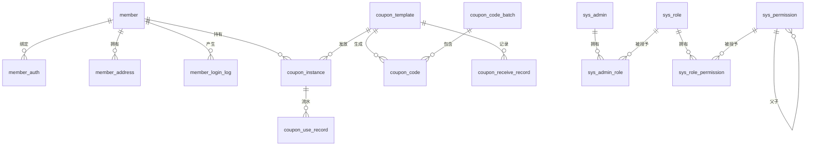

# 02 数据库设计

> 数据库：MySQL 8.0（InnoDB / utf8mb4）
> 迁移工具：Flyway
> 金额单位：分（BIGINT）
> 时区：Asia/Shanghai
> 主键：雪花 ID（BIGINT UNSIGNED）

---

## 1. 设计规范

### 1.1 命名

| 对象 | 规范 | 示例 |
| --- | --- | --- |
| 表 | 小写 + 下划线，按域前缀 | `member`、`sys_admin`、`coupon_template` |
| 字段 | 小写 + 下划线 | `phone_hash`、`valid_end` |
| 主键 | `id` | `id` |
| 唯一索引 | `uk_<字段>` | `uk_phone_hash` |
| 普通索引 | `idx_<字段组合>` | `idx_member_status_end` |
| 布尔 | `tinyint`，0/1，字段名不用 `is_` 前缀也可 | `stackable`、`visible` |

### 1.2 通用约定

- 所有表使用 InnoDB、`utf8mb4`、`utf8mb4_0900_ai_ci`。
- **不使用数据库外键**，关联完整性由应用层保证，避免锁与迁移阻碍。
- 所有金额 `BIGINT NOT NULL DEFAULT 0`，单位分。
- 时间 `DATETIME(3)`，默认 `CURRENT_TIMESTAMP(3)`。
- 状态字段用 `TINYINT`，含义写在 `COMMENT` 中，Java 侧用枚举映射。
- 需要并发控制的表带 `version INT NOT NULL DEFAULT 0`（MyBatis-Plus 乐观锁）。
- 需要软删除的表带 `deleted TINYINT NOT NULL DEFAULT 0`；会员表不软删（用 `status`），避免手机号唯一索引冲突。
- 业务编号（会员号、券号、模板号）使用字符串唯一索引，便于运营与客服检索。
- 单表字段数控制在 40 以内；大文本与 JSON 单独评估。
- 所有字段必须有 `COMMENT`。

### 1.3 索引原则

- 高频等值查询建唯一索引或普通索引；
- 组合索引遵循最左前缀，区分度高的列在前；
- 列表默认按 `created_at DESC` 或业务时间排序，索引覆盖排序列；
- 避免超过 5 个索引；写多读少的日志表只保留必要索引；
- 禁止在索引列上使用函数或隐式类型转换。

### 1.4 金额与时间

- 所有价格、优惠、门槛使用分，避免浮点误差。
- 折扣率使用 `DECIMAL(4,2)`，如 `8.50` 表示 8.5 折。
- 数据库与应用统一 `Asia/Shanghai`；JDBC 连接串显式指定 `serverTimezone=Asia/Shanghai`。
- 有效期判断使用数据库 `NOW(3)` 或应用时间，**同一事务内只使用一种时间源**。

---

## 2. ER 模型



---

## 3. 会员域

### 3.1 member（会员）

```sql
CREATE TABLE `member` (
  `id`              BIGINT UNSIGNED NOT NULL COMMENT '会员ID（雪花）',
  `member_no`       VARCHAR(32)     NOT NULL COMMENT '会员编号，对外展示',
  `nickname`        VARCHAR(64)     NOT NULL DEFAULT '' COMMENT '昵称',
  `avatar_url`      VARCHAR(512)    NOT NULL DEFAULT '' COMMENT '头像URL',
  `phone_cipher`    VARBINARY(256)  NOT NULL COMMENT '手机号密文：AES-256-GCM',
  `phone_hash`      CHAR(64)        NOT NULL COMMENT '手机号HMAC-SHA256（hex），唯一与检索',
  `phone_masked`    VARCHAR(20)     NOT NULL DEFAULT '' COMMENT '脱敏手机号，如138****8888',
  `gender`          TINYINT         NOT NULL DEFAULT 0 COMMENT '0未知 1男 2女',
  `birthday`        DATE            NULL COMMENT '生日',
  `level_id`        BIGINT UNSIGNED NOT NULL DEFAULT 0 COMMENT '会员等级ID（预留）',
  `status`          TINYINT         NOT NULL DEFAULT 1 COMMENT '1正常 0禁用 2注销中 3已注销',
  `register_source` VARCHAR(20)     NOT NULL DEFAULT 'H5' COMMENT '注册来源 PC/H5/APP/MINI',
  `token_version`   INT             NOT NULL DEFAULT 0 COMMENT 'Token版本，改密/全端下线时+1',
  `last_login_at`   DATETIME(3)     NULL COMMENT '最后登录时间',
  `version`         INT             NOT NULL DEFAULT 0 COMMENT '乐观锁',
  `created_at`      DATETIME(3)     NOT NULL DEFAULT CURRENT_TIMESTAMP(3),
  `updated_at`      DATETIME(3)     NOT NULL DEFAULT CURRENT_TIMESTAMP(3) ON UPDATE CURRENT_TIMESTAMP(3),
  PRIMARY KEY (`id`),
  UNIQUE KEY `uk_member_no` (`member_no`),
  UNIQUE KEY `uk_phone_hash` (`phone_hash`),
  KEY `idx_status_created` (`status`, `created_at`),
  KEY `idx_last_login` (`last_login_at`)
) ENGINE=InnoDB DEFAULT CHARSET=utf8mb4 COLLATE=utf8mb4_0900_ai_ci COMMENT='会员';
```

说明：

- 不软删除；注销使用 `status=3`，手机号仍占用，防止被他人重新注册产生数据归属问题。
- 手机号密文格式：`version(1B) + nonce(12B) + ciphertext + tag(16B)`，密钥来自环境变量并支持轮换。
- `phone_hash` 使用独立 pepper，不能与加密密钥相同。

### 3.2 member_auth（会员认证方式）

```sql
CREATE TABLE `member_auth` (
  `id`            BIGINT UNSIGNED NOT NULL COMMENT 'ID（雪花）',
  `member_id`     BIGINT UNSIGNED NOT NULL COMMENT '会员ID',
  `identity_type` VARCHAR(20)     NOT NULL COMMENT 'PHONE/WECHAT_MINI/WECHAT_MP/APPLE',
  `identifier`    VARCHAR(128)    NOT NULL COMMENT '手机号哈希 / openid / unionid',
  `credential`    VARCHAR(255)    NOT NULL DEFAULT '' COMMENT '密码哈希或凭证密文',
  `extra`         JSON            NULL COMMENT '扩展信息，如session_key密文',
  `status`        TINYINT         NOT NULL DEFAULT 1 COMMENT '1有效 0失效',
  `created_at`    DATETIME(3)     NOT NULL DEFAULT CURRENT_TIMESTAMP(3),
  `updated_at`    DATETIME(3)     NOT NULL DEFAULT CURRENT_TIMESTAMP(3) ON UPDATE CURRENT_TIMESTAMP(3),
  PRIMARY KEY (`id`),
  UNIQUE KEY `uk_identity` (`identity_type`, `identifier`),
  KEY `idx_member` (`member_id`)
) ENGINE=InnoDB DEFAULT CHARSET=utf8mb4 COLLATE=utf8mb4_0900_ai_ci COMMENT='会员认证方式';
```

说明：

- 手机号注册时写入 `identity_type=PHONE`、`identifier=phone_hash`、`credential=BCrypt`。
- 小程序接入时写入 `WECHAT_MINI + openid`；`unionid` 可与公众号/APP 打通。
- 一个会员可绑定多种认证方式。

### 3.3 member_address（收货地址）

```sql
CREATE TABLE `member_address` (
  `id`             BIGINT UNSIGNED NOT NULL COMMENT '地址ID（雪花）',
  `member_id`      BIGINT UNSIGNED NOT NULL COMMENT '会员ID',
  `receiver_name`  VARCHAR(64)     NOT NULL COMMENT '收货人',
  `phone_cipher`   VARBINARY(256)  NOT NULL COMMENT '收货手机号密文',
  `phone_masked`   VARCHAR(20)     NOT NULL DEFAULT '' COMMENT '脱敏手机号',
  `province_code`  VARCHAR(12)     NOT NULL DEFAULT '' COMMENT '省编码',
  `province_name`  VARCHAR(64)     NOT NULL DEFAULT '' COMMENT '省名称',
  `city_code`      VARCHAR(12)     NOT NULL DEFAULT '' COMMENT '市编码',
  `city_name`      VARCHAR(64)     NOT NULL DEFAULT '' COMMENT '市名称',
  `district_code`  VARCHAR(12)     NOT NULL DEFAULT '' COMMENT '区县编码',
  `district_name`  VARCHAR(64)     NOT NULL DEFAULT '' COMMENT '区县名称',
  `detail`         VARCHAR(255)    NOT NULL COMMENT '详细地址',
  `postal_code`    VARCHAR(12)     NOT NULL DEFAULT '' COMMENT '邮编',
  `is_default`     TINYINT         NOT NULL DEFAULT 0 COMMENT '1默认地址 0否',
  `version`        INT             NOT NULL DEFAULT 0 COMMENT '乐观锁',
  `deleted`        TINYINT         NOT NULL DEFAULT 0 COMMENT '1已删除',
  `created_at`     DATETIME(3)     NOT NULL DEFAULT CURRENT_TIMESTAMP(3),
  `updated_at`     DATETIME(3)     NOT NULL DEFAULT CURRENT_TIMESTAMP(3) ON UPDATE CURRENT_TIMESTAMP(3),
  PRIMARY KEY (`id`),
  KEY `idx_member_deleted` (`member_id`, `deleted`, `is_default`),
  KEY `idx_member_created` (`member_id`, `created_at`)
) ENGINE=InnoDB DEFAULT CHARSET=utf8mb4 COLLATE=utf8mb4_0900_ai_ci COMMENT='会员收货地址';
```

说明：默认地址唯一性在应用层事务内保证（先清零再置一），不建数据库唯一索引。

### 3.4 member_login_log（登录日志）

```sql
CREATE TABLE `member_login_log` (
  `id`          BIGINT UNSIGNED NOT NULL COMMENT 'ID（雪花）',
  `member_id`   BIGINT UNSIGNED NOT NULL DEFAULT 0 COMMENT '会员ID，登录失败时可能为0',
  `account`     VARCHAR(128)    NOT NULL DEFAULT '' COMMENT '登录账号（脱敏）',
  `client_type` VARCHAR(20)     NOT NULL COMMENT 'PC/H5/APP/MINI',
  `login_type`  VARCHAR(20)     NOT NULL COMMENT 'PASSWORD/SMS/WECHAT_MINI/REFRESH',
  `device_id`   VARCHAR(64)     NOT NULL DEFAULT '' COMMENT '设备标识',
  `ip`          VARCHAR(45)     NOT NULL DEFAULT '' COMMENT '客户端IP（IPv6兼容）',
  `user_agent`  VARCHAR(512)    NOT NULL DEFAULT '' COMMENT 'UA',
  `success`     TINYINT         NOT NULL COMMENT '1成功 0失败',
  `fail_reason` VARCHAR(128)    NOT NULL DEFAULT '' COMMENT '失败原因',
  `created_at`  DATETIME(3)     NOT NULL DEFAULT CURRENT_TIMESTAMP(3),
  PRIMARY KEY (`id`),
  KEY `idx_member_created` (`member_id`, `created_at`),
  KEY `idx_ip_created` (`ip`, `created_at`)
) ENGINE=InnoDB DEFAULT CHARSET=utf8mb4 COLLATE=utf8mb4_0900_ai_ci COMMENT='会员登录日志';
```

说明：按月归档或分区；一期保留 180 天，后续由清理任务处理。

---

## 4. 管理端权限域

### 4.1 sys_admin（管理员）

```sql
CREATE TABLE `sys_admin` (
  `id`                 BIGINT UNSIGNED NOT NULL COMMENT '管理员ID（雪花）',
  `username`           VARCHAR(64)     NOT NULL COMMENT '登录名',
  `password`           VARCHAR(100)    NOT NULL COMMENT '密码哈希，{bcrypt}$2a$...',
  `nickname`           VARCHAR(64)     NOT NULL DEFAULT '' COMMENT '昵称',
  `avatar_url`         VARCHAR(512)    NOT NULL DEFAULT '' COMMENT '头像',
  `email`              VARCHAR(128)    NOT NULL DEFAULT '' COMMENT '邮箱',
  `status`             TINYINT         NOT NULL DEFAULT 1 COMMENT '1启用 0禁用',
  `pwd_reset_required` TINYINT         NOT NULL DEFAULT 1 COMMENT '1首次登录需改密',
  `last_login_at`      DATETIME(3)     NULL COMMENT '最后登录时间',
  `last_login_ip`      VARCHAR(45)     NOT NULL DEFAULT '' COMMENT '最后登录IP',
  `version`            INT             NOT NULL DEFAULT 0 COMMENT '乐观锁',
  `created_at`         DATETIME(3)     NOT NULL DEFAULT CURRENT_TIMESTAMP(3),
  `updated_at`         DATETIME(3)     NOT NULL DEFAULT CURRENT_TIMESTAMP(3) ON UPDATE CURRENT_TIMESTAMP(3),
  PRIMARY KEY (`id`),
  UNIQUE KEY `uk_username` (`username`),
  KEY `idx_status` (`status`)
) ENGINE=InnoDB DEFAULT CHARSET=utf8mb4 COLLATE=utf8mb4_0900_ai_ci COMMENT='后台管理员';
```

### 4.2 sys_role（角色）

```sql
CREATE TABLE `sys_role` (
  `id`          BIGINT UNSIGNED NOT NULL COMMENT '角色ID（雪花）',
  `code`        VARCHAR(64)     NOT NULL COMMENT '角色编码，如SUPER_ADMIN',
  `name`        VARCHAR(64)     NOT NULL COMMENT '角色名称',
  `description` VARCHAR(255)    NOT NULL DEFAULT '' COMMENT '描述',
  `data_scope`  TINYINT         NOT NULL DEFAULT 1 COMMENT '1全部 2仅本人',
  `status`      TINYINT         NOT NULL DEFAULT 1 COMMENT '1启用 0禁用',
  `sort`        INT             NOT NULL DEFAULT 0 COMMENT '排序',
  `created_at`  DATETIME(3)     NOT NULL DEFAULT CURRENT_TIMESTAMP(3),
  `updated_at`  DATETIME(3)     NOT NULL DEFAULT CURRENT_TIMESTAMP(3) ON UPDATE CURRENT_TIMESTAMP(3),
  PRIMARY KEY (`id`),
  UNIQUE KEY `uk_code` (`code`)
) ENGINE=InnoDB DEFAULT CHARSET=utf8mb4 COLLATE=utf8mb4_0900_ai_ci COMMENT='角色';
```

### 4.3 sys_permission（权限/菜单）

```sql
CREATE TABLE `sys_permission` (
  `id`              BIGINT UNSIGNED NOT NULL COMMENT '权限ID（雪花）',
  `parent_id`       BIGINT UNSIGNED NOT NULL DEFAULT 0 COMMENT '父ID，0为根',
  `permission_type` TINYINT         NOT NULL COMMENT '1目录 2菜单 3按钮 4接口',
  `code`            VARCHAR(100)    NOT NULL COMMENT '权限码：domain:resource:action',
  `name`            VARCHAR(64)     NOT NULL COMMENT '名称',
  `route_path`      VARCHAR(255)    NOT NULL DEFAULT '' COMMENT '前端路由',
  `component`       VARCHAR(255)    NOT NULL DEFAULT '' COMMENT '前端组件',
  `api_method`      VARCHAR(10)     NOT NULL DEFAULT '' COMMENT 'HTTP方法（接口权限用）',
  `api_path`        VARCHAR(255)    NOT NULL DEFAULT '' COMMENT '接口路径（接口权限用）',
  `icon`            VARCHAR(64)     NOT NULL DEFAULT '' COMMENT '图标',
  `sort`            INT             NOT NULL DEFAULT 0 COMMENT '排序',
  `visible`         TINYINT         NOT NULL DEFAULT 1 COMMENT '菜单是否可见',
  `status`          TINYINT         NOT NULL DEFAULT 1 COMMENT '1启用 0禁用',
  `created_at`      DATETIME(3)     NOT NULL DEFAULT CURRENT_TIMESTAMP(3),
  `updated_at`      DATETIME(3)     NOT NULL DEFAULT CURRENT_TIMESTAMP(3) ON UPDATE CURRENT_TIMESTAMP(3),
  PRIMARY KEY (`id`),
  UNIQUE KEY `uk_code` (`code`),
  KEY `idx_parent` (`parent_id`, `sort`)
) ENGINE=InnoDB DEFAULT CHARSET=utf8mb4 COLLATE=utf8mb4_0900_ai_ci COMMENT='权限/菜单';
```

### 4.4 关联表

```sql
CREATE TABLE `sys_admin_role` (
  `admin_id` BIGINT UNSIGNED NOT NULL COMMENT '管理员ID',
  `role_id`  BIGINT UNSIGNED NOT NULL COMMENT '角色ID',
  PRIMARY KEY (`admin_id`, `role_id`),
  KEY `idx_role` (`role_id`)
) ENGINE=InnoDB DEFAULT CHARSET=utf8mb4 COLLATE=utf8mb4_0900_ai_ci COMMENT='管理员-角色';

CREATE TABLE `sys_role_permission` (
  `role_id`       BIGINT UNSIGNED NOT NULL COMMENT '角色ID',
  `permission_id` BIGINT UNSIGNED NOT NULL COMMENT '权限ID',
  PRIMARY KEY (`role_id`, `permission_id`),
  KEY `idx_permission` (`permission_id`)
) ENGINE=InnoDB DEFAULT CHARSET=utf8mb4 COLLATE=utf8mb4_0900_ai_ci COMMENT='角色-权限';
```

### 4.5 sys_operation_log（操作日志）

```sql
CREATE TABLE `sys_operation_log` (
  `id`              BIGINT UNSIGNED NOT NULL COMMENT 'ID（雪花）',
  `admin_id`        BIGINT UNSIGNED NOT NULL DEFAULT 0 COMMENT '操作人ID',
  `admin_username`  VARCHAR(64)     NOT NULL DEFAULT '' COMMENT '操作人用户名',
  `module`          VARCHAR(64)     NOT NULL DEFAULT '' COMMENT '模块',
  `action`          VARCHAR(64)     NOT NULL DEFAULT '' COMMENT '动作',
  `method`          VARCHAR(10)     NOT NULL DEFAULT '' COMMENT 'HTTP方法',
  `uri`             VARCHAR(255)    NOT NULL DEFAULT '' COMMENT '请求路径',
  `request_params`  TEXT            NULL COMMENT '请求参数摘要（脱敏、截断）',
  `success`         TINYINT         NOT NULL DEFAULT 1 COMMENT '1成功 0失败',
  `result_code`     INT             NOT NULL DEFAULT 0 COMMENT '业务码',
  `error_msg`       VARCHAR(512)    NOT NULL DEFAULT '' COMMENT '错误信息',
  `ip`              VARCHAR(45)     NOT NULL DEFAULT '' COMMENT '客户端IP',
  `user_agent`      VARCHAR(512)    NOT NULL DEFAULT '' COMMENT 'UA',
  `cost_ms`         INT             NOT NULL DEFAULT 0 COMMENT '耗时毫秒',
  `trace_id`        VARCHAR(64)     NOT NULL DEFAULT '' COMMENT '链路ID',
  `created_at`      DATETIME(3)     NOT NULL DEFAULT CURRENT_TIMESTAMP(3),
  PRIMARY KEY (`id`),
  KEY `idx_admin_created` (`admin_id`, `created_at`),
  KEY `idx_created` (`created_at`),
  KEY `idx_trace` (`trace_id`)
) ENGINE=InnoDB DEFAULT CHARSET=utf8mb4 COLLATE=utf8mb4_0900_ai_ci COMMENT='后台操作日志';
```

说明：操作日志只插入不更新；按月清理或归档。

---

## 5. 优惠券域

### 5.1 coupon_template（券模板）

```sql
CREATE TABLE `coupon_template` (
  `id`                  BIGINT UNSIGNED NOT NULL COMMENT '模板ID（雪花）',
  `template_no`         VARCHAR(32)     NOT NULL COMMENT '模板编号，对外展示',
  `name`                VARCHAR(128)    NOT NULL COMMENT '券名称',
  `coupon_type`         TINYINT         NOT NULL COMMENT '1满减 2折扣 3无门槛',
  `scope_type`          TINYINT         NOT NULL DEFAULT 1 COMMENT '1全场 2类目 3SPU 4SKU',
  `scope_values`        JSON            NULL COMMENT '适用范围：{"include":[],"exclude":[]}',
  `threshold_amount`    BIGINT          NOT NULL DEFAULT 0 COMMENT '使用门槛（分），0为无门槛',
  `discount_amount`     BIGINT          NOT NULL DEFAULT 0 COMMENT '满减/无门槛券优惠金额（分）',
  `discount_rate`       DECIMAL(4,2)    NULL COMMENT '折扣率，8.50表示8.5折',
  `max_discount_amount` BIGINT          NOT NULL DEFAULT 0 COMMENT '折扣券封顶（分），0不封顶',
  `total_quantity`      INT             NOT NULL DEFAULT 0 COMMENT '发放总量，0为不限量',
  `issued_quantity`     INT             NOT NULL DEFAULT 0 COMMENT '已发放数量',
  `per_user_limit`      INT             NOT NULL DEFAULT 1 COMMENT '每人限领',
  `validity_type`       TINYINT         NOT NULL COMMENT '1固定区间 2领取后N天',
  `valid_start`         DATETIME(3)     NULL COMMENT '固定有效期开始',
  `valid_end`           DATETIME(3)     NULL COMMENT '固定有效期结束',
  `valid_days`          INT             NOT NULL DEFAULT 0 COMMENT '领取后有效天数',
  `receive_start`       DATETIME(3)     NULL COMMENT '领取开始时间',
  `receive_end`         DATETIME(3)     NULL COMMENT '领取结束时间',
  `stack_group`         VARCHAR(32)     NOT NULL DEFAULT 'PLATFORM' COMMENT '叠加组，同组互斥',
  `stackable`           TINYINT         NOT NULL DEFAULT 1 COMMENT '1可与其他组叠加 0不可',
  `refund_policy`       TINYINT         NOT NULL DEFAULT 1 COMMENT '1退款退券 2不退',
  `receive_channels`    VARCHAR(64)     NOT NULL DEFAULT 'ALL' COMMENT '可领取渠道，逗号分隔',
  `sort_weight`         INT             NOT NULL DEFAULT 0 COMMENT '券中心排序权重，越大越前',
  `status`              TINYINT         NOT NULL DEFAULT 0 COMMENT '0草稿 1已发布 2已下线',
  `remark`              VARCHAR(255)    NOT NULL DEFAULT '' COMMENT '备注',
  `version`             INT             NOT NULL DEFAULT 0 COMMENT '乐观锁',
  `created_by`          BIGINT UNSIGNED NOT NULL DEFAULT 0 COMMENT '创建人',
  `updated_by`          BIGINT UNSIGNED NOT NULL DEFAULT 0 COMMENT '更新人',
  `created_at`          DATETIME(3)     NOT NULL DEFAULT CURRENT_TIMESTAMP(3),
  `updated_at`          DATETIME(3)     NOT NULL DEFAULT CURRENT_TIMESTAMP(3) ON UPDATE CURRENT_TIMESTAMP(3),
  PRIMARY KEY (`id`),
  UNIQUE KEY `uk_template_no` (`template_no`),
  KEY `idx_status_receive` (`status`, `receive_start`, `receive_end`),
  KEY `idx_created` (`created_at`)
) ENGINE=InnoDB DEFAULT CHARSET=utf8mb4 COLLATE=utf8mb4_0900_ai_ci COMMENT='优惠券模板';
```

约束（应用层校验）：

- `coupon_type=1` 或 `3` 时 `discount_amount > 0`；
- `coupon_type=2` 时 `discount_rate` 在 `0.10 ~ 9.99`；
- `validity_type=1` 时 `valid_start < valid_end`；
- `validity_type=2` 时 `valid_days > 0`；
- `total_quantity = 0` 或 `total_quantity >= issued_quantity`；
- `receive_start < receive_end`。

### 5.2 coupon_instance（用户券）

```sql
CREATE TABLE `coupon_instance` (
  `id`              BIGINT UNSIGNED NOT NULL COMMENT '券实例ID（雪花）',
  `coupon_no`       VARCHAR(32)     NOT NULL COMMENT '券号，对外展示',
  `template_id`     BIGINT UNSIGNED NOT NULL COMMENT '模板ID',
  `member_id`       BIGINT UNSIGNED NOT NULL COMMENT '持有人ID',
  `status`          TINYINT         NOT NULL DEFAULT 1 COMMENT '1未使用 2锁定 3已使用 4已过期 5已冻结',
  `source`          VARCHAR(20)     NOT NULL DEFAULT 'CLAIM' COMMENT 'CLAIM/CODE/ADMIN',
  `receive_channel` VARCHAR(20)     NOT NULL DEFAULT '' COMMENT '领取渠道',
  `receive_time`    DATETIME(3)     NOT NULL COMMENT '领取时间',
  `valid_start`     DATETIME(3)     NOT NULL COMMENT '有效期开始',
  `valid_end`       DATETIME(3)     NOT NULL COMMENT '有效期结束',
  `used_time`       DATETIME(3)     NULL COMMENT '使用时间',
  `order_no`        VARCHAR(64)     NOT NULL DEFAULT '' COMMENT '核销订单号',
  `lock_order_no`   VARCHAR(64)     NOT NULL DEFAULT '' COMMENT '当前锁定订单号',
  `discount_amount` BIGINT          NOT NULL DEFAULT 0 COMMENT '实际优惠金额（分）',
  `version`         INT             NOT NULL DEFAULT 0 COMMENT '乐观锁',
  `created_at`      DATETIME(3)     NOT NULL DEFAULT CURRENT_TIMESTAMP(3),
  `updated_at`      DATETIME(3)     NOT NULL DEFAULT CURRENT_TIMESTAMP(3) ON UPDATE CURRENT_TIMESTAMP(3),
  PRIMARY KEY (`id`),
  UNIQUE KEY `uk_coupon_no` (`coupon_no`),
  KEY `idx_member_status_end` (`member_id`, `status`, `valid_end`),
  KEY `idx_template` (`template_id`),
  KEY `idx_status_end` (`status`, `valid_end`),
  KEY `idx_order_no` (`order_no`),
  KEY `idx_lock_order_no` (`lock_order_no`)
) ENGINE=InnoDB DEFAULT CHARSET=utf8mb4 COLLATE=utf8mb4_0900_ai_ci COMMENT='用户优惠券实例';
```

### 5.3 coupon_code_batch（券码批次）

```sql
CREATE TABLE `coupon_code_batch` (
  `id`          BIGINT UNSIGNED NOT NULL COMMENT '批次ID（雪花）',
  `batch_no`    VARCHAR(32)     NOT NULL COMMENT '批次号',
  `template_id` BIGINT UNSIGNED NOT NULL COMMENT '模板ID',
  `total`       INT             NOT NULL COMMENT '生成本次数量',
  `status`      TINYINT         NOT NULL DEFAULT 1 COMMENT '1已生成 2生成中 3失败',
  `created_by`  BIGINT UNSIGNED NOT NULL DEFAULT 0 COMMENT '创建人',
  `created_at`  DATETIME(3)     NOT NULL DEFAULT CURRENT_TIMESTAMP(3),
  `updated_at`  DATETIME(3)     NOT NULL DEFAULT CURRENT_TIMESTAMP(3) ON UPDATE CURRENT_TIMESTAMP(3),
  PRIMARY KEY (`id`),
  UNIQUE KEY `uk_batch_no` (`batch_no`),
  KEY `idx_template` (`template_id`)
) ENGINE=InnoDB DEFAULT CHARSET=utf8mb4 COLLATE=utf8mb4_0900_ai_ci COMMENT='券码批次';
```

### 5.4 coupon_code（券码）

```sql
CREATE TABLE `coupon_code` (
  `id`          BIGINT UNSIGNED NOT NULL COMMENT '券码ID（雪花）',
  `code`        VARCHAR(32)     NOT NULL COMMENT '券码，16位大写字母数字',
  `batch_id`    BIGINT UNSIGNED NOT NULL COMMENT '批次ID',
  `template_id` BIGINT UNSIGNED NOT NULL COMMENT '模板ID',
  `status`      TINYINT         NOT NULL DEFAULT 1 COMMENT '1未使用 2已使用 3已作废',
  `member_id`   BIGINT UNSIGNED NOT NULL DEFAULT 0 COMMENT '兑换会员ID',
  `used_time`   DATETIME(3)     NULL COMMENT '兑换时间',
  `created_at`  DATETIME(3)     NOT NULL DEFAULT CURRENT_TIMESTAMP(3),
  `updated_at`  DATETIME(3)     NOT NULL DEFAULT CURRENT_TIMESTAMP(3) ON UPDATE CURRENT_TIMESTAMP(3),
  PRIMARY KEY (`id`),
  UNIQUE KEY `uk_code` (`code`),
  KEY `idx_batch_status` (`batch_id`, `status`),
  KEY `idx_template_status` (`template_id`, `status`),
  KEY `idx_member` (`member_id`)
) ENGINE=InnoDB DEFAULT CHARSET=utf8mb4 COLLATE=utf8mb4_0900_ai_ci COMMENT='优惠券码';
```

### 5.5 coupon_receive_record（领取记录）

```sql
CREATE TABLE `coupon_receive_record` (
  `id`           BIGINT UNSIGNED NOT NULL COMMENT 'ID（雪花）',
  `request_no`   VARCHAR(64)     NOT NULL COMMENT '幂等键（Idempotency-Key）',
  `member_id`    BIGINT UNSIGNED NOT NULL COMMENT '会员ID',
  `template_id`  BIGINT UNSIGNED NOT NULL COMMENT '模板ID',
  `channel`      VARCHAR(20)     NOT NULL DEFAULT '' COMMENT '渠道',
  `source`       VARCHAR(20)     NOT NULL DEFAULT 'CLAIM' COMMENT 'CLAIM/CODE/ADMIN',
  `success`      TINYINT         NOT NULL COMMENT '1成功 0失败',
  `fail_reason`  VARCHAR(128)    NOT NULL DEFAULT '' COMMENT '失败原因',
  `coupon_id`    BIGINT UNSIGNED NOT NULL DEFAULT 0 COMMENT '成功时的券实例ID',
  `created_at`   DATETIME(3)     NOT NULL DEFAULT CURRENT_TIMESTAMP(3),
  PRIMARY KEY (`id`),
  UNIQUE KEY `uk_request_no` (`request_no`),
  KEY `idx_member_template` (`member_id`, `template_id`, `created_at`),
  KEY `idx_template_created` (`template_id`, `created_at`)
) ENGINE=InnoDB DEFAULT CHARSET=utf8mb4 COLLATE=utf8mb4_0900_ai_ci COMMENT='领券记录';
```

说明：

- `request_no` 由客户端 `Idempotency-Key` 或服务端生成；唯一索引保证重复请求只成功一次。
- 失败记录用于风控与运营分析，不影响重试（客户端可使用新的幂等键）。

### 5.6 coupon_use_record（使用流水）

```sql
CREATE TABLE `coupon_use_record` (
  `id`              BIGINT UNSIGNED NOT NULL COMMENT 'ID（雪花）',
  `coupon_id`       BIGINT UNSIGNED NOT NULL COMMENT '券实例ID',
  `coupon_no`       VARCHAR(32)     NOT NULL COMMENT '券号',
  `member_id`       BIGINT UNSIGNED NOT NULL COMMENT '会员ID',
  `template_id`     BIGINT UNSIGNED NOT NULL COMMENT '模板ID',
  `order_no`        VARCHAR(64)     NOT NULL DEFAULT '' COMMENT '订单号',
  `action`          TINYINT         NOT NULL COMMENT '1锁券 2核销 3释放 4过期 5退券 6冻结 7解冻',
  `before_status`   TINYINT         NOT NULL COMMENT '变更前状态',
  `after_status`    TINYINT         NOT NULL COMMENT '变更后状态',
  `discount_amount` BIGINT          NOT NULL DEFAULT 0 COMMENT '优惠金额（分）',
  `operator_type`   VARCHAR(20)     NOT NULL DEFAULT 'SYSTEM' COMMENT 'MEMBER/ADMIN/SYSTEM',
  `operator_id`     BIGINT UNSIGNED NOT NULL DEFAULT 0 COMMENT '操作人ID',
  `remark`          VARCHAR(255)    NOT NULL DEFAULT '' COMMENT '备注/失败原因',
  `trace_id`        VARCHAR(64)     NOT NULL DEFAULT '' COMMENT '链路ID',
  `created_at`      DATETIME(3)     NOT NULL DEFAULT CURRENT_TIMESTAMP(3),
  PRIMARY KEY (`id`),
  UNIQUE KEY `uk_coupon_action_order` (`coupon_id`, `action`, `order_no`),
  KEY `idx_order_no` (`order_no`),
  KEY `idx_member_created` (`member_id`, `created_at`)
) ENGINE=InnoDB DEFAULT CHARSET=utf8mb4 COLLATE=utf8mb4_0900_ai_ci COMMENT='优惠券使用流水';
```

说明：唯一键用于动作幂等；`order_no` 为空表示非订单动作（过期、冻结、解冻）。

### 5.7 coupon_stack_rule（叠加规则）

```sql
CREATE TABLE `coupon_stack_rule` (
  `id`              BIGINT UNSIGNED NOT NULL COMMENT 'ID（雪花）',
  `group_a`         VARCHAR(32)     NOT NULL COMMENT '叠加组A',
  `group_b`         VARCHAR(32)     NOT NULL COMMENT '叠加组B，字典序保证唯一',
  `allow_stack`     TINYINT         NOT NULL DEFAULT 1 COMMENT '1可叠加 0互斥',
  `max_stack_count` TINYINT         NOT NULL DEFAULT 3 COMMENT '该组合下最大叠加张数',
  `status`          TINYINT         NOT NULL DEFAULT 1 COMMENT '1启用 0禁用',
  `created_at`      DATETIME(3)     NOT NULL DEFAULT CURRENT_TIMESTAMP(3),
  `updated_at`      DATETIME(3)     NOT NULL DEFAULT CURRENT_TIMESTAMP(3) ON UPDATE CURRENT_TIMESTAMP(3),
  PRIMARY KEY (`id`),
  UNIQUE KEY `uk_groups` (`group_a`, `group_b`)
) ENGINE=InnoDB DEFAULT CHARSET=utf8mb4 COLLATE=utf8mb4_0900_ai_ci COMMENT='优惠券叠加规则';
```

说明：

- 写入时把两个组按字典序排序，保证 `(A,B)` 与 `(B,A)` 只有一条。
- 同组互斥是硬规则，不查表。
- 未配置的组合默认互斥（fail-safe）。

---

## 6. 初始化数据

### 6.1 权限种子

Flyway 迁移 `V*__seed_rbac.sql` 写入权限树（ID 使用固定值，便于关联）：

| 权限码 | 类型 | 名称 |
| --- | --- | --- |
| `system` | 目录 | 系统管理 |
| `system:admin:view` / `create` / `update` / `delete` / `assign-role` | 按钮 | 管理员管理 |
| `system:role:view` / `create` / `update` / `delete` / `assign-permission` | 按钮 | 角色管理 |
| `system:permission:view` / `create` / `update` / `delete` | 按钮 | 权限管理 |
| `system:log:view` | 按钮 | 操作日志 |
| `member` | 目录 | 会员管理 |
| `member:member:view` / `update-status` | 按钮 | 会员管理 |
| `coupon` | 目录 | 优惠券 |
| `coupon:template:view` / `create` / `update` / `delete` / `publish` / `offline` | 按钮 | 券模板 |
| `coupon:code:view` / `generate` / `void` | 按钮 | 券码 |
| `coupon:instance:view` / `freeze` / `unfreeze` | 按钮 | 用户券 |
| `coupon:rule:view` / `update` | 按钮 | 叠加规则 |

角色：

- `SUPER_ADMIN`：全部权限（代码短路，无需逐条关联）；
- 预留 `OPERATOR`（只读 + 发券）、`CUSTOMER_SERVICE`（查询会员与券）。

### 6.2 管理员初始化

**不在 Flyway 中写入默认密码**。应用启动时执行 `AdminInitializer`：

- 读取环境变量 `ADMIN_INIT_USERNAME`、`ADMIN_INIT_PASSWORD`；
- 若不存在该管理员则创建，`pwd_reset_required=1`；
- 未配置时跳过并输出 WARN；
- 密码使用 BCrypt 编码后入库。

### 6.3 叠加规则默认值

| group_a | group_b | allow_stack | max_stack_count |
| --- | --- | --- | --- |
| `BRAND` | `CATEGORY` | 1 | 3 |
| `BRAND` | `PLATFORM` | 1 | 3 |
| `CATEGORY` | `PLATFORM` | 1 | 3 |

> 同组互斥；`max_stack_count` 取组合中的最小值。

---

## 7. Flyway 迁移策略

### 7.1 目录与命名

```text
mall-bootstrap/src/main/resources/db/migration/
├── V20261121001__create_member.sql
├── V20261121002__create_rbac.sql
├── V20261121003__create_coupon.sql
├── V20261121004__seed_rbac.sql
└── V20261121005__seed_coupon_stack_rule.sql
```

- 使用时间戳版本号，避免多人协作冲突；
- 已执行的迁移文件**禁止修改**，修正用新版本；
- 生产环境禁止 `clean`；
- `baseline-on-migrate=true` 仅用于接管存量库，新库直接执行。

### 7.2 规范

- 一个迁移只做一件事（建表 / 加索引 / 种子数据）；
- DDL 必须可重复评审，包含字符集、索引、注释；
- 大表加索引使用 `ALGORITHM=INPLACE, LOCK=NONE`（MySQL 8 多数场景自动）；
- 数据修复脚本与结构变更分开；
- 上线前在预发环境执行 `flyway validate` + 全量回归。

### 7.3 回滚

Flyway 社区版不支持自动回滚。策略：

- 优先**前向修复**（新增迁移）；
- 高风险变更采用"双写/双读 + 兼容列"分步上线；
- 上线前备份，保留 binlog 恢复能力。

---

## 8. 数据安全与生命周期

| 数据 | 策略 |
| --- | --- |
| 手机号 | AES-256-GCM 加密 + HMAC 哈希检索；展示脱敏 |
| 密码 | BCrypt；不可逆；禁止日志输出 |
| Token | 只存 refresh 哈希；access 不落库 |
| 登录/操作日志 | 保留 180 天，脱敏后归档 |
| 已注销会员 | 手机号保留占位，昵称/头像匿名化，业务数据按法规处理 |
| 券数据 | 长期保留用于对账；券码作废不删除 |
| 备份 | MySQL 每日全备 + binlog；保留 7 天全备，30 天 binlog |

---

## 9. 关键 SQL 模式

### 9.1 乐观锁更新

```sql
UPDATE coupon_instance
SET status = 2, lock_order_no = #{orderNo}, version = version + 1
WHERE id = #{couponId}
  AND member_id = #{memberId}
  AND status = 1
  AND valid_end > NOW(3)
  AND version = #{version};
```

### 9.2 库存扣减

```sql
UPDATE coupon_template
SET issued_quantity = issued_quantity + 1, version = version + 1
WHERE id = #{templateId}
  AND (total_quantity = 0 OR issued_quantity < total_quantity);
```

### 9.3 每用户限领校验

```sql
SELECT COUNT(1)
FROM coupon_instance
WHERE member_id = #{memberId} AND template_id = #{templateId};
```

在事务内执行；配合 Redis 计数做前置拦截。极端并发下由数据库唯一约束与事务隔离兜底（限领为 1 时，可在 `coupon_receive_record` 增加 `uk_member_template_once` 的生成列方案，一期先用事务内计数 + Redis）。

### 9.4 过期券批量处理

```sql
UPDATE coupon_instance
SET status = 4, version = version + 1
WHERE status = 1 AND valid_end < NOW(3)
LIMIT 500;
```

循环执行直到影响行数为 0，每批独立事务，避免长事务与锁等待。

### 9.5 我的券分页

```sql
SELECT *
FROM coupon_instance
WHERE member_id = #{memberId}
  AND status = #{status}
ORDER BY created_at DESC
LIMIT #{offset}, #{pageSize};
```

索引 `idx_member_status_end` 覆盖过滤；深分页超过 10 万时改用游标（`id < lastId`）。
