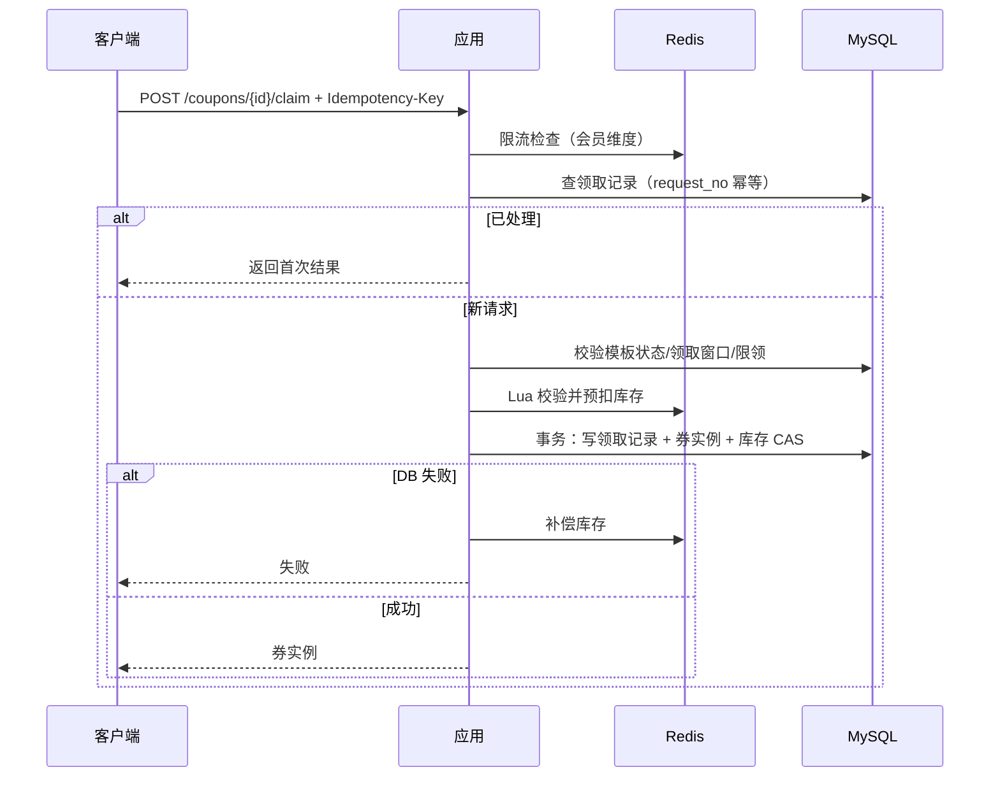
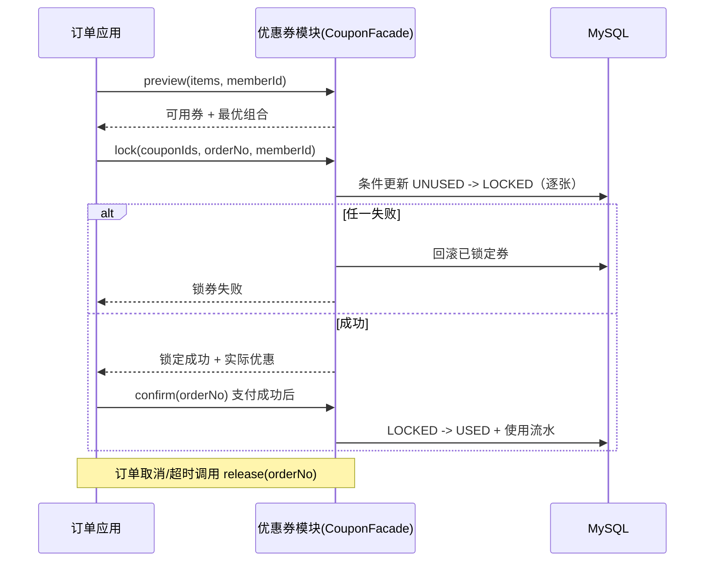
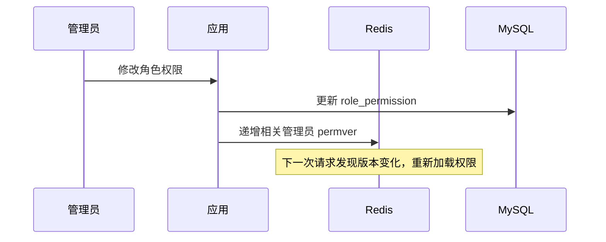

# 03 API 设计

> Base URL：`https://api.example.com`
> 版本：`/api/v1`
> 协议：HTTPS + JSON（UTF-8）
> 认证：`Authorization: Bearer <accessToken>`

---

## 1. 通用规范

### 1.1 接口分组

| 分组 | 前缀 | 身份 |
| --- | --- | --- |
| 会员端 | `/api/v1/member/**` | 会员 JWT（`aud=member`） |
| 管理端 | `/api/v1/admin/**` | 管理员 JWT（`aud=admin`） |

PC、H5、APP、小程序共用会员端接口；端差异通过请求头与少量专属接口处理。

### 1.2 请求头

| Header | 必填 | 说明 |
| --- | --- | --- |
| `Authorization` | 登录后必填 | `Bearer <accessToken>` |
| `Content-Type` | POST/PUT 必填 | `application/json` |
| `X-Client-Type` | 登录及关键接口必填 | `PC` / `H5` / `APP` / `MINI` |
| `X-Device-Id` | 登录必填 | 设备唯一标识，8–64 位 |
| `X-App-Version` | 否 | 客户端版本 |
| `X-Request-Id` | 否 | 客户端请求 ID，服务端回写 `traceId` |
| `Idempotency-Key` | 写操作建议 | 8–64 位，同一业务重试需保持相同 |

### 1.3 统一响应

```json
{
  "code": 0,
  "message": "ok",
  "data": {},
  "traceId": "0af7651916cd43dd8448eb211c80319c",
  "timestamp": "2026-11-21 12:00:00"
}
```

- `code=0` 表示成功；非 0 见错误码表。
- HTTP 状态码与错误类型对应：400 参数、401 未认证、403 无权限、404 不存在、409 状态冲突、429 限流、500 系统错误。
- **所有 `Long` 类型 ID 序列化为字符串**，避免前端 JS 精度丢失。
- 时间格式 `yyyy-MM-dd HH:mm:ss`，时区 `Asia/Shanghai`。

### 1.4 分页

请求：

| 参数 | 类型 | 默认 | 说明 |
| --- | --- | --- | --- |
| `page` | int | 1 | 从 1 开始 |
| `pageSize` | int | 10 | 最大 100 |

响应：

```json
{
  "records": [],
  "page": 1,
  "pageSize": 10,
  "total": 0,
  "pages": 0
}
```

### 1.5 错误码

| code | HTTP | 含义 |
| --- | --- | --- |
| `0` | 200 | 成功 |
| `40001` | 400 | 参数校验失败 |
| `40002` | 400 | 请求体格式错误 |
| `40003` | 400 | 不支持的客户端类型 |
| `40100` | 401 | 未登录 / 缺少 Token |
| `40101` | 401 | Access Token 已过期 |
| `40102` | 401 | Token 已失效（被下线 / 版本变更） |
| `40103` | 401 | 账号或密码错误 |
| `40104` | 423 | 账号锁定，请稍后再试 |
| `40105` | 403 | 无权限 |
| `40106` | 400 | 验证码错误或已过期 |
| `40107` | 403 | 账号已被禁用 |
| `40108` | 401 | 刷新令牌无效或被重放 |
| `40109` | 403 | 身份类型不匹配（会员访问后台等） |
| `41001` | 409 | 手机号已注册 |
| `41002` | 404 | 会员不存在 |
| `41003` | 404 | 地址不存在 |
| `41004` | 409 | 地址数量已达上限（20） |
| `41005` | 400 | 密码不符合策略 |
| `41006` | 400 | 原密码错误 |
| `41007` | 429 | 验证码发送过于频繁 |
| `42001` | 409 | 活动未开始 |
| `42002` | 409 | 活动已结束 |
| `42003` | 409 | 优惠券已领完 |
| `42004` | 409 | 超过每人限领数量 |
| `42005` | 404 | 优惠券不存在或不属于当前用户 |
| `42006` | 400 | 券码无效 |
| `42007` | 409 | 券码已被使用 |
| `42008` | 409 | 券状态不允许该操作 |
| `42009` | 400 | 未满足使用条件（门槛 / 适用范围） |
| `42010` | 409 | 优惠券已过期 |
| `42011` | 409 | 不满足叠加规则 |
| `42012` | 409 | 优惠券已冻结 |
| `42013` | 409 | 券码已作废 |
| `42014` | 409 | 幂等键已被不同请求使用 |
| `50000` | 500 | 系统内部错误 |
| `50001` | 502 | 外部服务不可用（短信 / 微信） |

### 1.6 限流策略（服务端）

| 接口 | 维度 | 阈值 |
| --- | --- | --- |
| 登录 | 账号 + IP | 5 次失败/15 分钟；IP 10 次/分钟 |
| 短信发送 | 手机号 / IP | 1 次/60 秒；10 次/天 / IP 20 次/天 |
| 领券 | 会员 | 20 次/分钟 |
| 券码兑换 | 会员 | 10 次/分钟，失败 5 次锁定 10 分钟 |
| 试算 | 会员 | 60 次/分钟 |
| 管理端登录 | 账号 + IP | 5 次失败/15 分钟 |

超限返回 `429`，响应头带 `Retry-After`。

---

## 2. 会员端接口

### 2.1 认证

| 方法 | 路径 | 认证 | 说明 |
| --- | --- | --- | --- |
| POST | `/api/v1/member/auth/sms-code` | 否 | 发送短信验证码（场景：REGISTER/LOGIN/RESET_PASSWORD/BIND） |
| POST | `/api/v1/member/auth/register` | 否 | 手机号 + 验证码 + 密码注册 |
| POST | `/api/v1/member/auth/login` | 否 | 密码或验证码登录 |
| POST | `/api/v1/member/auth/refresh` | 否 | 刷新令牌（轮换） |
| POST | `/api/v1/member/auth/logout` | 是 | 退出当前设备 |
| POST | `/api/v1/member/auth/logout-all` | 是 | 退出全部设备 |
| GET | `/api/v1/member/auth/sessions` | 是 | 多端会话列表 |
| DELETE | `/api/v1/member/auth/sessions/{deviceId}` | 是 | 下线指定设备 |
| POST | `/api/v1/member/auth/password/reset` | 否 | 验证码重置密码 |
| PUT | `/api/v1/member/auth/password` | 是 | 修改密码 |
| POST | `/api/v1/member/auth/wechat/mini/login` | 否 | 小程序登录（预留） |

#### 2.1.1 发送验证码

```http
POST /api/v1/member/auth/sms-code
Content-Type: application/json

{
  "phone": "13800138000",
  "scene": "REGISTER"
}
```

```json
{ "code": 0, "message": "ok", "data": { "expireSeconds": 300, "resendAfterSeconds": 60 } }
```

开发环境响应中额外返回 `debugCode`（仅 `dev` profile），生产不返回。

#### 2.1.2 注册

```json
{
  "phone": "13800138000",
  "smsCode": "123456",
  "password": "Abc123456",
  "nickname": "小明",
  "clientType": "H5",
  "deviceId": "6f1c2d3e-..."
}
```

成功后直接返回登录态：

```json
{
  "code": 0,
  "data": {
    "accessToken": "eyJhbGciOiJIUzI1NiIs...",
    "refreshToken": "r_9f2c8...",
    "tokenType": "Bearer",
    "expiresIn": 1800,
    "member": {
      "id": "100000000000000001",
      "memberNo": "M20261121000001",
      "nickname": "小明",
      "phoneMasked": "138****8000",
      "avatarUrl": ""
    }
  }
}
```

#### 2.1.3 登录

```json
{
  "account": "13800138000",
  "loginType": "PASSWORD",
  "password": "Abc123456",
  "clientType": "APP",
  "deviceId": "6f1c2d3e-..."
}
```

验证码登录时：

```json
{
  "account": "13800138000",
  "loginType": "SMS",
  "smsCode": "123456",
  "clientType": "H5",
  "deviceId": "6f1c2d3e-..."
}
```

#### 2.1.4 刷新令牌

```json
{ "refreshToken": "r_9f2c8...", "deviceId": "6f1c2d3e-..." }
```

- 刷新成功后旧 refresh 立即失效，返回新的 access + refresh。
- 旧 refresh 被再次使用视为重放，撤销该设备会话并返回 `40108`。

#### 2.1.5 小程序登录（预留）

```http
POST /api/v1/member/auth/wechat/mini/login
```

```json
{
  "code": "wx.login 返回的 code",
  "encryptedPhone": "",
  "iv": "",
  "deviceId": "mini-device-uuid",
  "clientType": "MINI"
}
```

服务端流程：`code2Session` → 查 `member_auth(WECHAT_MINI, openid)` → 存在则登录；不存在则创建会员（未绑定手机号需后续绑定）→ 返回登录态。手机号授权通过 `encryptedPhone + iv` 解密后绑定。

### 2.2 个人资料

| 方法 | 路径 | 说明 |
| --- | --- | --- |
| GET | `/api/v1/member/profile` | 获取当前会员资料 |
| PUT | `/api/v1/member/profile` | 修改昵称、性别、生日 |
| POST | `/api/v1/member/profile/avatar` | 上传头像（multipart，≤2MB，jpg/png/webp） |

资料响应示例：

```json
{
  "id": "100000000000000001",
  "memberNo": "M20261121000001",
  "nickname": "小明",
  "phoneMasked": "138****8000",
  "avatarUrl": "https://cdn.example.com/avatar/xxx.png",
  "gender": 1,
  "birthday": "1995-06-01",
  "status": 1,
  "createdAt": "2026-11-21 12:00:00"
}
```

### 2.3 收货地址

| 方法 | 路径 | 说明 |
| --- | --- | --- |
| GET | `/api/v1/member/addresses` | 地址列表（默认地址在前） |
| POST | `/api/v1/member/addresses` | 新增地址（上限 20） |
| GET | `/api/v1/member/addresses/{id}` | 地址详情 |
| PUT | `/api/v1/member/addresses/{id}` | 修改地址 |
| DELETE | `/api/v1/member/addresses/{id}` | 删除地址（软删） |
| PUT | `/api/v1/member/addresses/{id}/default` | 设为默认地址 |

新增请求：

```json
{
  "receiverName": "张三",
  "phone": "13800138000",
  "provinceCode": "310000",
  "provinceName": "上海市",
  "cityCode": "310100",
  "cityName": "上海市",
  "districtCode": "310115",
  "districtName": "浦东新区",
  "detail": "世纪大道 100 号 8 楼",
  "postalCode": "200120",
  "isDefault": true
}
```

响应中的手机号只返回 `phoneMasked`。

### 2.4 优惠券

| 方法 | 路径 | 认证 | 说明 |
| --- | --- | --- | --- |
| GET | `/api/v1/member/coupons/center` | 是 | 领券中心（已发布、领取窗口内、可领） |
| GET | `/api/v1/member/coupons/center/{templateId}` | 是 | 券模板详情 |
| POST | `/api/v1/member/coupons/{templateId}/claim` | 是 | 领取优惠券 |
| POST | `/api/v1/member/coupons/redeem` | 是 | 券码兑换 |
| GET | `/api/v1/member/coupons` | 是 | 我的券（status 过滤：UNUSED/USED/EXPIRED） |
| GET | `/api/v1/member/coupons/{couponId}` | 是 | 券详情 |
| GET | `/api/v1/member/coupons/counts` | 是 | 各状态数量（角标） |
| POST | `/api/v1/member/coupons/preview` | 是 | 下单试算 / 智能选券 |

#### 2.4.1 领券

```http
POST /api/v1/member/coupons/100000000000000100/claim
Idempotency-Key: 7f3a9c2e-1b4d-4e6f-9a0b-2c8d7e6f5a4b
X-Client-Type: APP
```

```json
{
  "code": 0,
  "message": "ok",
  "data": {
    "couponId": "100000000000009001",
    "couponNo": "C20261121000009001",
    "name": "满 100 减 20",
    "status": 1,
    "validStart": "2026-11-21 12:00:00",
    "validEnd": "2026-12-21 23:59:59"
  }
}
```

失败示例：

```json
{ "code": 42004, "message": "超过每人限领数量", "data": null, "traceId": "..." }
```

实现要求：

- 同一 `Idempotency-Key` 重复请求返回首次结果，不重复发券；
- 库存扣减以数据库条件更新为准；
- 成功与失败都写 `coupon_receive_record`（失败记录不影响新幂等键重试）。

#### 2.4.2 券码兑换

```json
{ "code": "AB12CD34EF56GH78" }
```

成功返回券实例；失败区分 `42006` / `42007` / `42013` / `42001` / `42002`。

#### 2.4.3 我的券

```http
GET /api/v1/member/coupons?status=UNUSED&page=1&pageSize=10
```

```json
{
  "records": [
    {
      "id": "100000000000009001",
      "couponNo": "C20261121000009001",
      "templateId": "100000000000000100",
      "name": "满 100 减 20",
      "type": "FULL_REDUCTION",
      "thresholdAmount": 10000,
      "discountAmount": 2000,
      "status": "UNUSED",
      "validStart": "2026-11-21 12:00:00",
      "validEnd": "2026-12-21 23:59:59",
      "scopeDesc": "全场通用",
      "stackGroup": "PLATFORM"
    }
  ],
  "page": 1,
  "pageSize": 10,
  "total": 1,
  "pages": 1
}
```

#### 2.4.4 试算 / 智能选券

```http
POST /api/v1/member/coupons/preview
```

```json
{
  "items": [
    { "skuId": "20001", "spuId": "30001", "categoryId": "40001", "quantity": 2, "unitPrice": 5990 }
  ],
  "selectedCouponIds": ["100000000000009001"]
}
```

- `selectedCouponIds` 为空时返回最优组合；不为空时按用户选择校验。
- 一期价格由调用方传入，服务端只做规则计算；订单域接入后改为服务端从商品/价格域取价。

```json
{
  "itemsAmount": 11980,
  "bestMatch": {
    "couponIds": ["100000000000009001", "100000000000009002"],
    "discountAmount": 2500,
    "payAmount": 9480
  },
  "availableCoupons": [
    {
      "couponId": "100000000000009001",
      "name": "满 100 减 20",
      "discountAmount": 2000,
      "applicableAmount": 11980,
      "stackGroup": "PLATFORM"
    }
  ],
  "unavailableCoupons": [
    {
      "couponId": "100000000000009003",
      "name": "满 300 减 50",
      "reasonCode": "42009",
      "reason": "适用商品金额未满 300 元"
    }
  ]
}
```

---

## 3. 管理端接口

### 3.1 认证

| 方法 | 路径 | 权限 | 说明 |
| --- | --- | --- | --- |
| POST | `/api/v1/admin/auth/login` | 公开 | 用户名密码登录 |
| POST | `/api/v1/admin/auth/refresh` | 公开 | 刷新令牌 |
| POST | `/api/v1/admin/auth/logout` | 已登录 | 退出 |
| GET | `/api/v1/admin/auth/me` | 已登录 | 当前管理员、权限码、菜单树 |
| PUT | `/api/v1/admin/auth/password` | 已登录 | 修改密码（首次登录强制） |

登录请求：

```json
{ "username": "admin", "password": "********", "deviceId": "admin-web-uuid" }
```

`/me` 响应：

```json
{
  "admin": { "id": "1", "username": "admin", "nickname": "超级管理员" },
  "permissions": ["coupon:template:view", "coupon:template:create", "member:member:view"],
  "menus": [
    {
      "id": "100",
      "name": "优惠券",
      "code": "coupon",
      "routePath": "/coupon",
      "icon": "coupon",
      "children": [
        { "id": "101", "name": "券模板", "code": "coupon:template:view", "routePath": "/coupon/templates" }
      ]
    }
  ],
  "pwdResetRequired": false
}
```

### 3.2 系统管理

| 方法 | 路径 | 权限码 | 说明 |
| --- | --- | --- | --- |
| GET | `/api/v1/admin/system/admins` | `system:admin:view` | 管理员分页 |
| POST | `/api/v1/admin/system/admins` | `system:admin:create` | 新建管理员 |
| PUT | `/api/v1/admin/system/admins/{id}` | `system:admin:update` | 修改管理员 |
| PUT | `/api/v1/admin/system/admins/{id}/status` | `system:admin:update` | 启用/禁用 |
| PUT | `/api/v1/admin/system/admins/{id}/roles` | `system:admin:assign-role` | 分配角色 |
| DELETE | `/api/v1/admin/system/admins/{id}` | `system:admin:delete` | 删除（逻辑禁用） |
| GET | `/api/v1/admin/system/roles` | `system:role:view` | 角色列表 |
| POST | `/api/v1/admin/system/roles` | `system:role:create` | 新建角色 |
| PUT | `/api/v1/admin/system/roles/{id}` | `system:role:update` | 修改角色 |
| PUT | `/api/v1/admin/system/roles/{id}/permissions` | `system:role:assign-permission` | 角色授权 |
| DELETE | `/api/v1/admin/system/roles/{id}` | `system:role:delete` | 删除角色 |
| GET | `/api/v1/admin/system/permissions/tree` | `system:permission:view` | 权限树 |
| POST | `/api/v1/admin/system/permissions` | `system:permission:create` | 新建权限 |
| PUT | `/api/v1/admin/system/permissions/{id}` | `system:permission:update` | 修改权限 |
| DELETE | `/api/v1/admin/system/permissions/{id}` | `system:permission:delete` | 删除权限 |
| GET | `/api/v1/admin/system/operation-logs` | `system:log:view` | 操作日志分页 |

角色授权请求：

```json
{ "permissionIds": ["100", "101", "102"] }
```

说明：

- 内置 `SUPER_ADMIN` 不可删除、不可修改权限；
- 修改角色/管理员角色后，递增相关管理员权限版本，最迟下次请求生效；
- 管理员密码重置由具备权限的管理员操作，重置后 `pwdResetRequired=1` 并踢下线。

### 3.3 会员管理

| 方法 | 路径 | 权限码 | 说明 |
| --- | --- | --- | --- |
| GET | `/api/v1/admin/members` | `member:member:view` | 会员分页（手机号精确搜索，脱敏展示） |
| GET | `/api/v1/admin/members/{id}` | `member:member:view` | 会员详情 |
| PUT | `/api/v1/admin/members/{id}/status` | `member:member:update-status` | 启用/禁用 |

查询参数：`keyword`（会员号/昵称/手机号精确）、`status`、`startTime`、`endTime`。

> 手机号仅支持精确匹配（哈希索引），不提供模糊查询。详情中的手机号默认脱敏，查看完整号码需单独权限（二期）。

### 3.4 优惠券管理

| 方法 | 路径 | 权限码 | 说明 |
| --- | --- | --- | --- |
| GET | `/api/v1/admin/coupons/templates` | `coupon:template:view` | 模板分页 |
| GET | `/api/v1/admin/coupons/templates/{id}` | `coupon:template:view` | 模板详情 |
| POST | `/api/v1/admin/coupons/templates` | `coupon:template:create` | 新建模板（草稿） |
| PUT | `/api/v1/admin/coupons/templates/{id}` | `coupon:template:update` | 修改草稿/已下线模板 |
| DELETE | `/api/v1/admin/coupons/templates/{id}` | `coupon:template:delete` | 删除草稿（有发放记录则拒绝） |
| POST | `/api/v1/admin/coupons/templates/{id}/publish` | `coupon:template:publish` | 发布 |
| POST | `/api/v1/admin/coupons/templates/{id}/offline` | `coupon:template:offline` | 下线 |
| POST | `/api/v1/admin/coupons/templates/{id}/codes/generate` | `coupon:code:generate` | 批量生成券码 |
| GET | `/api/v1/admin/coupons/templates/{id}/codes` | `coupon:code:view` | 券码分页 |
| POST | `/api/v1/admin/coupons/codes/{code}/void` | `coupon:code:void` | 作废券码 |
| GET | `/api/v1/admin/coupons/instances` | `coupon:instance:view` | 用户券分页 |
| POST | `/api/v1/admin/coupons/instances/{id}/freeze` | `coupon:instance:freeze` | 冻结 |
| POST | `/api/v1/admin/coupons/instances/{id}/unfreeze` | `coupon:instance:unfreeze` | 解冻 |
| POST | `/api/v1/admin/coupons/grant` | `coupon:template:publish` | 定向发券（会员ID列表） |
| GET | `/api/v1/admin/coupons/stack-rules` | `coupon:rule:view` | 叠加规则列表 |
| PUT | `/api/v1/admin/coupons/stack-rules` | `coupon:rule:update` | 更新叠加规则 |

新建模板请求：

```json
{
  "name": "满 100 减 20",
  "couponType": 1,
  "scopeType": 1,
  "scopeValues": { "include": [], "exclude": [] },
  "thresholdAmount": 10000,
  "discountAmount": 2000,
  "totalQuantity": 10000,
  "perUserLimit": 1,
  "validityType": 1,
  "validStart": "2026-12-01 00:00:00",
  "validEnd": "2026-12-31 23:59:59",
  "receiveStart": "2026-11-25 00:00:00",
  "receiveEnd": "2026-12-30 23:59:59",
  "stackGroup": "PLATFORM",
  "stackable": 1,
  "refundPolicy": 1,
  "receiveChannels": "ALL",
  "sortWeight": 100
}
```

发布校验：

- 必填与数值合法性；
- 领取/有效期时间顺序；
- 库存与限领；
- 折扣券封顶；
- 发布后关键字段（类型、面额、门槛、总量）不可修改，只能下线重建。

批量生成券码：

```json
{ "count": 1000 }
```

返回 `batchNo`、`count`、`status`。单次上限 50,000，超过 5,000 转异步并返回任务标识。

定向发券：

```json
{
  "templateId": "100000000000000100",
  "memberIds": ["100000000000000001", "100000000000000002"],
  "reason": "客服补偿"
}
```

要求：单次最多 500 人；逐人幂等；返回成功/失败明细；写操作审计。

冻结/解冻请求需带 `reason`。

### 3.5 管理端通用要求

- 所有写操作由 `@OperationLog` 记录审计；
- 分页最大 100；
- 敏感字段（手机号）默认脱敏；
- 导出接口后续单独设计，异步生成文件，禁止同步大结果集。

---

## 4. 关键流程

### 4.1 领券流程



### 4.2 下单试算与核销（与订单域协作）



要求：

- `lock` 时服务端重新计算优惠，不信任客户端金额；
- 一个订单多张券时在同一事务内逐张锁定，失败全部回滚；
- `confirm` / `release` 幂等；
- 订单退款调用 `returnOnRefund`。

### 4.3 权限变更生效



---

## 5. OpenAPI 与文档

- 使用 springdoc 生成，分组：
  - `member-api`：`/api/v1/member/**`
  - `admin-api`：`/api/v1/admin/**`
- 开发/测试环境开放 `/swagger-ui.html`；生产关闭。
- DTO 上使用 `@Schema` 描述字段与示例，错误码在文档中统一列出。
- 接口变更需同步更新本文档；以代码注解与本文档为准，二者不一致视为缺陷。

---

## 6. 兼容与演进

- 新增字段：直接追加，客户端忽略未知字段；
- 字段废弃：保留至少一个版本，文档标注 `deprecated`；
- 接口废弃：先停止新客户端调用，再下线；
- 小程序接入不改变现有会员端接口，只新增认证适配接口；
- 若未来拆分服务，`/api/v1/member/**` 与 `/api/v1/admin/**` 的对外契约保持不变，由网关路由。
